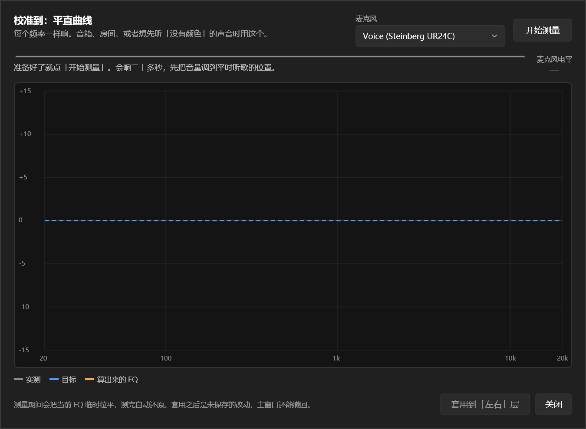
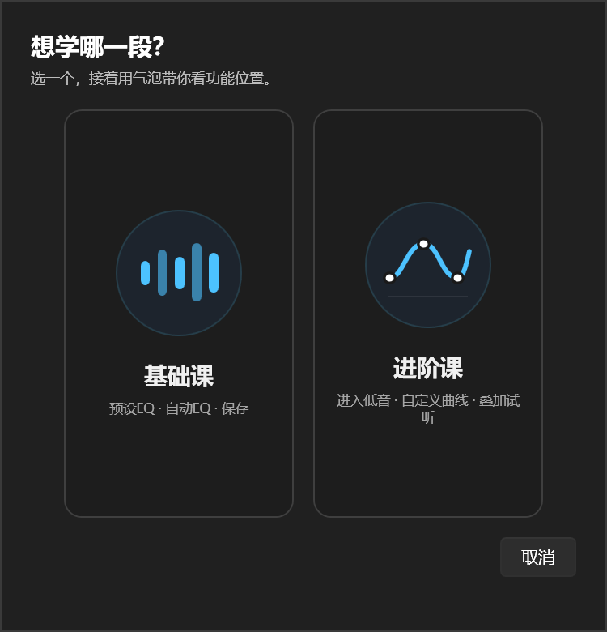
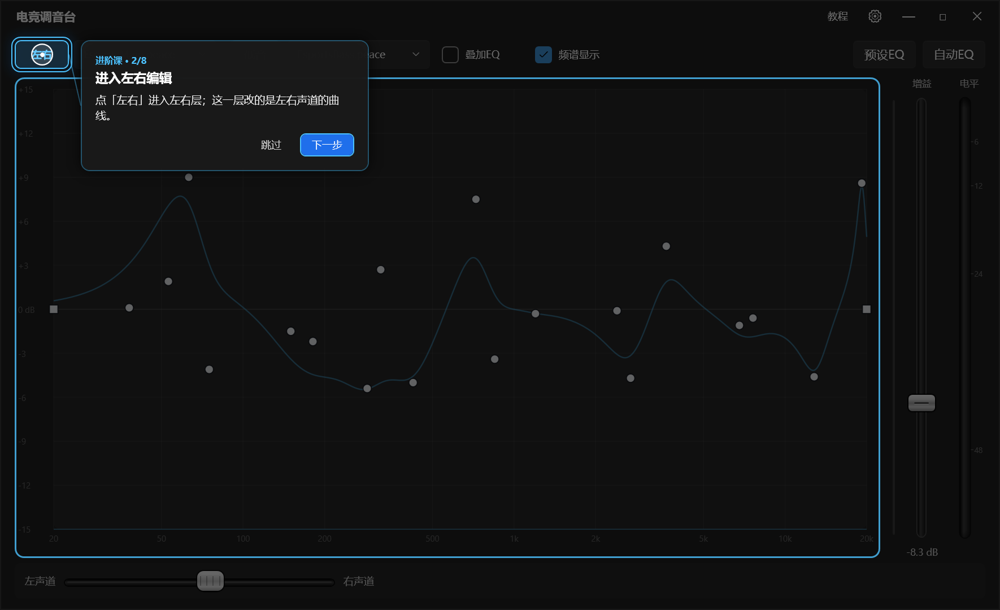

# 电竞调音台

把 Peace（EqualizerAPO 的图形界面）换成 WPF，并且不再依赖它运行：两层 EQ 各自对应一个 `.peace` 预设文件，保存时两份预设一起写，再合并成 `peace.txt` 交给 EqualizerAPO。

程序只认 EqualizerAPO 的 config 目录：不找 Peace 进程、不藏它的窗口、不发任何 `WM_APP` 消息。唯一要确认的是 `config.txt` 里有 `Include: peace.txt`——没挂上时设置窗口会提示，点一下「接入 APO」就接好（改之前先备份）。

## 三个模式

| 模式 | 界面上是什么 | 保存时落到哪 |
|---|---|---|
| 均衡 | 底部常驻的左右音量滑块（不用点模式按钮） | 拖完 450 ms 自动写进 `peace.txt` 的 `Channel: L/R` + `Preamp` |
| 左右 | 主 EQ 曲线 + 右侧预设下拉 | 写回选中的 `.peace`（默认 `EsportsMain.peace`），要按保存 |
| 低音 | 第二条 EQ 曲线 + 预设下拉 + "叠加"开关 | 写回选中的 `.peace`（默认 `EsportsBass.peace`），开关关着就不参与合并 |

右侧竖排是和曲线同高的增益滑块（Preamp，拖完即生效）加一条整体响度表。

下拉栏列出 EqualizerAPO config 目录里所有 `.peace` 预设。切换下拉时，当前层先自动写回旧文件，再载入新文件。"叠加"开关一改就立即保存，不弹询问。
下拉右边有个 `+`：新建一份从平直开始的空白预设，名字重了自动加序号，建完直接切过去。

保存 = 写主预设 + 写低音预设 + 把两层合并成 `peace.txt`。EqualizerAPO 监视配置文件，写完就生效，Peace 不会重建界面。

## AutoEQ

顶栏的 `预设EQ` 按钮打开一个选择窗口：左边搜耳机型号，右边是这条校正的频响曲线（横轴 20 Hz–20 kHz，小白点是滤波器中心；展开「看命令」才显示要写进 EqualizerAPO 的文本）。点「应用到「左右」层」就把整层曲线换成这份校正（预增益一起设好，可以撤回）。

数据是 Peace 自带的那四个结果库（Harman / IEF / IEF+低音 / OPRA），解开后放在 `src\PeaceWpf\AutoEqData\`，构建时跟着程序复制到输出目录。参数 EQ 和固定频带 EQ 能一键应用；图形 EQ 是卷积曲线，点模型写不出来，只能复制命令。

细节和格式说明见 `docs\AutoEQ.md`。

## 自动EQ

`预设EQ` 右边那个 `自动EQ` 按钮，是当场测量，不是查表：

1. 点开先问校准到哪条曲线——**平直**（音箱 / 房间）还是**哈曼**（入耳式耳机）；
2. 选麦克风，点「开始测量」，从 20 Hz 到 20 kHz 走 61 个频点，二十多秒；
3. 测完给出四条线：实测、目标、主层 EQ、低音层的低频矫正；图上还有一条黄色竖线，拖动它改「矫正起点」（40–400 Hz，默认 100）；
4. 点「套用矫正EQ」：左右层换成主层校正，低音层整层换成 20 Hz–矫正起点 的低频矫正，回主窗口试听、保存。

测量期间会把 `peace.txt` 临时写成平直，测完还原——不然扫频信号会被当前 EQ 再染一遍，补偿就叠了两层。
测量时不叠低音层（设备不一定发得出），只有「试听扫频」会临时叠加低频，放完自动还原。

拟合出来的主层 EQ 按速度档 16 / 23 / 28 段峰值滤波器，修正量夹在 +9 / −12 dB；低频层 20 Hz–矫正起点、±18 dB。



细节、限制和为什么要用步进正弦见 `docs\自动EQ.md`。

## 教程

右上角的 `教程` 按钮在设置齿轮左边，点开先选：

- **基础课（13 步）**：设置 → `预设EQ` → `自动EQ`（选目标 / 麦克风 / 测试模式 / 矫正起点 / 测量 / 套用）。
- **进阶课（9 步）**：预设 → 进左右编辑 → 真实曲线演示 → 高频段对比 → 低音编辑 → 叠加开关 → 低频段对比 → 总音量 → 风味。

遮罩全屏，目标控件亮着、其余压暗；圆形光标 + 鼠标图标演示动作，气泡给一句话说明。
指到 `设置` / `预设EQ` / `自动EQ` 时教程会打开对应窗口并跟进去，讲完自动关闭。
进阶课开始会把两层换成教程数据（左右平直、低音 100 Hz 以下抬高），结束时原样还原，不写预设。





完整步骤表、颜色规则、演示细节和验证方式见 [docs\教程.md](docs/教程.md)。

## 无延迟防爆音

顶栏「叠加低音修正」右边的 `无延迟防爆音` 开关，是在整条链路最后面挂一个削峰器（Airwindows ClipOnly3，MIT，随程序内置）：

- 打开时把 `Assets\ClipOnly364.dll` 复制到 APO 的 `config\VST\`，在 `protect.txt` 里写一行 `VSTPlugin: Library "…"`，再让 `config.txt` 末尾挂上 `Include: protect.txt`——顺序排在 `peace.txt` 之后，所以它看到的是 EQ 抬过之后的信号。
- 只削峰值，平时一个采样都不动。低频抬多少都不会把整体压小；代价是超过 −0.7 dBFS 的那一点会变成谐波。
- 关掉时 `protect.txt` 只剩一行注释，链路等于没有它。`peace.txt` 和两份 `.peace` 预设一个字节都不改。
- 开关状态存在 `ui-state.json`；上次开着的话，下次启动会把 DLL 和 `protect.txt` 补到位再挂上。

## 界面

- 标题栏左边"电竞调音台"，右上角是教程、设置、最小化、最大化、关闭
- 顶栏一排：`左右` / 预设下拉 / `低音` / 预设下拉 / `叠加低音修正` / `无延迟防爆音` / `频谱显示`；右边是 `预设EQ` / `自动EQ`
- 最小窗口宽度按顶栏内容的自然尺寸算（加载时和每次缩放各算一次），拖到最小时右边那排按钮也不会被盖掉；往后往顶栏加按钮、改字号、换缩放都不用回来手调数字
- 没有刷新按钮（重新读取藏在设置里，或者重启）
- 均衡滑块常驻底部，拖着就觉得声音偏了可以马上拉回来；增益滑块在曲线右侧竖着，和曲线一样高；再右边是响度表
- 曲线改动立即试听：改一下就写进 `peace.txt`，引擎读它，声音当场变；点保存才写回预设文件，点取消把 `peace.txt` 还原、声音跟着退回去，撤回 50 步
- 左右和低音各有一份自己的撤回栈：在两层之间切换只是换编辑对象，不弹保存框；
  退出到「两个都不编辑」时才问保存 / 放弃，保存会把两层一起写回

## 为什么是这个结构

Peace 原本靠 `WM_APP` 协议遥控，每写一段都会触发后端刷新，保存很慢。所以改成：

- 读：启动时读两层各自的 `.peace`；没有预设才退回本地 `ui-state.json`；再没有才解析 `peace.txt`
- 写：两份 `.peace` + 一份合并的 `peace.txt`
- Peace 只负责被收起来，不参与读写

## 前置条件

1. .NET 10 SDK（`dotnet --list-sdks` 能看到 10.x）
2. 机器上装好 EqualizerAPO，config 目录可写。装在 `Program Files` 下时默认只有管理员能写。程序启动会自己试写一次，写不了时设置窗口里挂红字，旁边有「检查权限」：点开先诊断是哪一类原因（程序跑在低完整性下 / 没提权 / 文件带只读位 / 被别的程序占着 / Defender 受控文件夹访问 / ACL 缺写权限），只对能修的那一类给按钮。**如果机器把 UAC 关了（`EnableLUA=0`），这一条最容易踩：程序会以低完整性运行，`Program Files` 对它只读，加权限、点授权、重启都没用**，要跑一次 `icacls "<config 目录>" /setintegritylevel (OI)(CI)L`（需要管理员，诊断窗口能一键复制这条命令）。详见 `docs\配置目录权限.md`。
3. **不需要装 Peace**。`config.txt` 里要有一行 `Include: peace.txt`，没有的话设置窗口会出现「接入 APO」按钮，点一下就好。
4. 不要同时用 Peace 原界面调 EQ：它会重写 `peace.txt`，把前端的修改冲掉。

## 构建与运行

最省事的办法：双击 `build-and-test.cmd`（它只是 `build-test.ps1` 的启动壳，输出全是英文，避免 cmd 代码页把中文显示成空白）。它做三件事——还原、编译、跑自测，然后把结果打在窗口里，最后停住等你看。想顺手启动程序就用 `build-and-test.cmd run`。日志写在 `restore.log`、`build.log`、`test.log`。

如果双击没反应（`.cmd` 关联被改坏之类），开一个 cmd 窗口，粘这一行：

```bat
powershell -NoProfile -ExecutionPolicy Bypass -File "D:\AHK\调音\build-test.ps1"
```

等价的手动命令：

```powershell
dotnet build PeaceWpf.slnx -c Debug
dotnet run --project src\PeaceWpf        # 或直接跑 run.cmd
```

自测（不需要后端）：

```powershell
dotnet run --project tests\PeaceWpf.Core.SelfTest -c Debug
```

开发时如果在 DSH 会话里跑构建产物，保存可能被 DSH 的文件沙箱挡住（写工作区外会抛 `UnauthorizedAccessException`）。`run.cmd` 会先把产物复制到 `%LOCALAPPDATA%\PeaceWpf\app` 再从那里启动，绕开这个问题。

想不动真实安装试界面，把 config 目录指到别处：

```powershell
$env:PEACEWPF_CONFIG_DIR = 'D:\tmp\apo-test\config'
dotnet run --project src\PeaceWpf
```

## 目录结构

```
src\PeaceWpf.Core\          不含 WPF 的核心逻辑，可单测
  Model\EqPoint             一个点：频率/增益/Q/滤波器类型/端点/稳定 Id（不可变）
  Model\EqPointList         点列表：增删改、夹取、端点保护、转快照
  Model\EqLayerSet          主层 + 低音层，合并规则
  Model\UiState             界面状态（两层曲线、开关、平衡、两个预设名）
  Model\EqLimits            段数、频率、Q 的取值，以及滤波器类型表（0 是 PK）
  AutoEq\AutoEqParser       Peace 那份压缩格式的解析（参数 / 固定频带 / 图形）
  AutoEq\AutoEqDatabase     一个结果库：切行、搜索、按需解析
  AutoEq\AutoEqProfile      一份等化：转成点、还原成 EqualizerAPO 命令
  AutoEq\AutoEqCatalog      四个库的位置与缓存
  Editing\EqDraft           草稿 / 已保存 / 脏标记 / 保存 / 取消
  Editing\UndoStack         撤回栈（整份点列表快照，50 步）
  Integration\EapoConfig    peace.txt 的生成与解析
  Integration\ConfigPermission  配置目录写权限的诊断与修复（只读位 / 占用 / Defender / ACL）
  Integration\ApoSetup      config.txt 里的 Include 检测与挂载（接上 APO 的唯一一道手续）
  Integration\PeaceConfig   .peace 预设的读写（保留 General/Speakers，写 [Filters] 段）
  Dsp\EqResponse            频响仿真（RBJ biquad，峰值 + 架式）
  Audio\SpectrumAnalyzer    频谱：环缓冲、Hann 窗、手写 FFT 8192、192 条对数频带（1/3 倍频程带通积分）
  Audio\LoopbackCaptureService  WASAPI loopback 抓系统输出，设备换了自动重连
  Audio\SweepPlan           自动EQ 的频点与时间安排（20 Hz–20 kHz，61 点，步进正弦）
  Audio\ToneSweepPlayer     生成并播放扫频，样本自己数，不会和界面进度脱节
  Audio\MicrophoneCaptureService  WASAPI 抓麦克风，攒成一段单声道采样
  Audio\SweepAnalyzer       把录音切段、量电平、归一化到 1 kHz（纯数学，可自测）
  Audio\SweepMeasureService 播放 + 录音 + 分析串成一次测量
  Calibration\TargetCurve   目标曲线：平直、哈曼（近似）
  Calibration\EqCurveFitter 测量 + 目标 → EQ 点：平滑、限幅、解线性系统、算预增益
  （原来还有 Protocol\ 与 Hosting\，整个 Peace 协议层已移出构建，原件在 attic\协议层\）
src\PeaceWpf\               WPF 界面
  AutoEqWindow              AutoEQ 选择窗口（选库、搜型号、预览命令、一键应用）
  AutoEqData\*.txt          四个 AutoEQ 结果库，构建时复制到输出目录
  Controls\EqGraphView      自绘曲线 + 点编辑 + 参考层 + 底部实时频谱
  ViewModels\MainViewModel  三模式、双层草稿、预设切换、合并保存、频谱开关、AutoEQ 应用
  ViewModels\MainMode       模式与脏标记选择
  SettingsWindow            设置（运行环境 / 常规设置 / 关于软件三栏）
  TutorialChoiceWindow      教程入口：先选基础还是进阶
  TutorialSteps             基础 13 步 / 进阶 9 步的步骤表，写明每步在哪个窗口
  TutorialOverlay           教程遮罩：全屏、跨窗口找目标、气泡、圆形光标、曲线演示、扫频对比
tests\PeaceWpf.Core.SelfTest  无框架依赖的断言程序（222 项）
```

## 保存格式

`config.txt`（EqualizerAPO 的入口，程序只在缺的时候追加一行，改之前先备份）：

```
Include: peace.txt
```

`peace.txt`：

```
Device: all
Preamp: -0.3 dB
Channel: R
Preamp: -6.0 dB
Channel: all
Filter 1: ON PK Fc 20 Hz Gain 0.0 dB Q 1.41
...
```

`.peace` 预设：

```
[Frequencies]
Frequency1=20
...
[Gains]
Gain1=0.0
...
[Qualities]
Quality1=1.41
...
[Filters]
Filter2=8
...
[General]
...
[Speakers]
...
```

写回时只替换 `[Frequencies]`/`[Gains]`/`[Qualities]`/`[Filters]`，其它段（其它声道组合、General、Speakers）原样保留；新建预设时套用同目录的 `0.peace` 当模板。`[Filters]` 只列不是 PK 的段（`Filter2=8` 表示第 2 段是 LSC），和 Peace 自己的写法一致。

## 协议里的坑（历史记录，代码里已经没有协议层）

下面这些是当年跟 Peace 的 `WM_APP` 通信时踩到的，留作参考；现在保存只写文件，一条都用不上。

1. **推子消息号是 101 起的**。注册写 `WM_APP+100+i`，处理函数却减 `WM_APP+101`。
2. **滤波器类型 0 是 PK**，`SetFilterType` 的 lParam 是序号 + 1。
3. **错误码和数据共用整数**：写操作才把负数当错误。
4. **加段要等主窗口显示才重建**；连续写会返回 -4，要重试。
5. **峰值接口有前置条件**，拿不到设备时返回 -6/-7。

## 当前进度

已完成（对应 `执行计划.md` 的 S0–S4，详见 `docs\S0-S4交付.md`）：

- S0 滤波器类型表与 `$FilterTypes` 对齐
- S1 点模型、双层合并、草稿、撤回、配置读写
- S2 曲线交互：建点、拖动、滚轮 Q、右键删除、悬停浮标、参考层虚线
- S3 撤回与重做：50 步
- S4 三模式按钮、预设下拉、"叠加"开关、平衡滑块、保存/取消、确认框
- S5 实时频谱：曲线底部半透明面积 + 亮线，60 帧，可开关，抓不到就留空（代码完成，待编译验证）
- 保存改为写两个 `.peace` + `peace.txt`，不再触发后端刷新
- 改名"电竞调音台"，加标题栏按钮和设置窗口
- S6 独立运行：删掉整个 Peace 协议层（`PeaceClient`/`Win32PeaceTransport`/`PeaceLauncher` 等，原件在 `attic\协议层\`），
  新增 `ApoSetup`：检测 `config.txt` 有没有挂 `peace.txt`，没挂就在设置窗口给一个「接入 APO」按钮，点一下追加一行（先备份）
- S9 AutoEQ：`预设EQ` 按钮 + 四个结果库 + 一键套到「左右」层；顺带把架式滤波器（LS/HS/LSC/HSC）打通
  `.peace`、`peace.txt`、曲线仿真、界面缓存四处（见 `docs\AutoEQ.md`）
- S9.5 自动EQ：`自动EQ` 按钮 + 扫频 + 麦克风 → 平直 / 哈曼两条目标曲线，一键套到「左右」层。
  步进正弦 61 点、按能量切段、按 1 kHz 归一化，19 段峰值滤波器解线性系统拟合（见 `docs\自动EQ.md`）
- S9.6 自动EQ 打磨：重复测到稳定才停（2–8 次）、第二轮起按陡缓补点、三档疏密跟速度走、
  曲线毛躁时自己放宽 Q、滤波器中心可以按实测挪出等距格点（`movableBands`）、
  波峰波谷上的 Q 自动调小（以「套上去更平」为准，`RelaxQuality`）、
  测完按钮变「继续测量」：先套用再测一轮，上一轮结果在测量期间不清空
- S9.7 自动EQ 低频矫正：`套用矫正EQ` 同时生成 20 Hz–矫正起点 的低频曲线、整层替换「低音」层；
  主层从矫正起点往上 1/6 倍频程起。低频按当前实测反相（平直）或补到目标（哈曼），
  上沿最后 20% 淡出到 0，提升上限 +18 dB。低频和主层走同一套 Q 搜索 / 按深度放宽 / 逐段收尾，避免锯齿。
  矫正起点默认 100 Hz，可以拖自动EQ 图上的黄色竖线改（40–400 Hz），拖完按同一份实测重算两层。
  测量期间不叠低音、试听扫频才临时叠加（设备不一定发得出那个声音）
- S11 配置目录权限：设置里「检查权限」→ 先分因再修（低完整性 / 没提权 / 只读位 / 被占用 / Defender 受控文件夹访问 / ACL 缺写权限）。
  低完整性只给命令不动手（程序改不了自己的令牌），其余能修的给按钮；动 ACL 之前备份原文，改完用真实写测试验证（见 `docs\配置目录权限.md`）
- 教程：右上角 `教程` 按钮（设置在它右边）先选基础 / 进阶，再用气泡 + 圆形光标 + 鼠标图标指功能位置；
  基础课 13 步、进阶课 9 步，进阶课用软件真实的曲线控件和扫频做演示（见 `docs\教程.md`）
- S14 风味定制：曲线编辑器右边一组「目标频段 + 增强 / 减弱」。八条固定推子（爆炸/载具、男声、女声、脚步、枪声、换弹/机械、齿音、空间/细节），
  按「左右」预设各存一份，只叠加进 `peace.txt`、不写进 `.peace`；曲线上每条风味各一条同色曲线 + 同色手柄 + 自己的图标（Lucide，ISC），
  颜色按彩虹顺序（红→橙→黄→黄绿→绿→青→蓝→紫），拖手柄改频率和增益、滚轮改 Q，不能增删（见 `docs\S14-风味定制.md`）

还没做：

- S7 预设管理（新建/重命名/删除）、设备
- S8 托盘、全局热键、峰值表、系统音量、单实例
- S10 打包发布

## 已知限制

- `peace.txt` 里是合并结果，两层分不开；两层以各自的 `.peace` 和 `ui-state.json` 为准。
- Peace 如果还在跑，它切预设/改参数会重写 `peace.txt`，下次保存会再写回去（S7 做冲突检测）。
- 程序不会自动改 `config.txt`：没挂上时要人点一下「接入 APO」，之后被别的程序改回去，还要再点一次。
- 点数不设上限；合并后超过 31 个时状态栏会提示「Peace 只显示前 31 个」，声音和 `peace.txt` 都是完整的。
- 点模型支持 PK 和四类架式（LS / HS / LSC / HSC，AutoEQ 用到的都在）；低通、高通、带通、陷波、全通这些读进来会丢并计数，保存时写成 PK（有提示）。
- 频率上界 20 kHz，原来的 22050 Hz 滤波器保存后会变成 20000 Hz。
- 试听是写 `peace.txt` 实现的：程序崩在试听中途时，留下的会是试听内容（预设文件没写，重开还是原来的曲线）。
- 频谱抓的是系统输出：播放器用 WASAPI 独占模式时可能抓不到，界面只是空着。
- 自动EQ 的结果是「麦克风 + 耳机/房间」的合成响应：麦克风本身不校准，房间反射也算在里面。
  测之前把麦克风放对位置，比事后调 EQ 有用。见 `docs\自动EQ.md`。
- 自动EQ 套用「矫正EQ」会同时写「左右」层和「低音」层：主层从矫正起点往上 1/6 倍频程起，
  低频 20 Hz–矫正起点 整层替换低音层。两层都是未保存的改动，仍要按保存；低音层的叠加开关会自动打开。
- 测量期间会临时把 `peace.txt` 写成平直；「继续测量」只写主层、不写低音层。
  低频矫正只在「试听扫频」时临时叠加（设备不一定发得出那个声音，叠进测量会算错），
  扫频放完自动还原。配置目录不可写时跳过拉平，结果里会带着现有 EQ——界面会写明。
- 如果机器关了 UAC（`EnableLUA=0`），程序会以低完整性跑，写 `Program Files\EqualizerAPO\config` 会被完整性级别挡住（在 ACL 之前）。
  解法是给这个目录降标签：`icacls "<config 目录>" /setintegritylevel (OI)(CI)L`，要管理员跑一次。
  重装 EqualizerAPO 后标签可能被重置，需要重新跑。见 `docs\配置目录权限.md`。
- 风味和曲线共用一条草稿：只调风味也会出现保存 / 取消，Ctrl+Z 能一步退回去，保存才写进 `ui-state.json`；
  它仍然不进 `.peace`（预设格式里没这一项）。
- 风味手柄画的是**设定值**；曲线图上每条风味各画一条自己的响应曲线，颜色和名称一致，选中的那条加粗，画在左右曲线下面。
  风味下拉固定在底部工具条上，列表一律向上弹，不会顶出屏幕。
  增益为 0 的风味不画（只有编辑态下、下拉里选中的那一条例外，否则没法从 0 拖起来）；右键手柄是把增益归零，不是删除。
  「左右」和「低音」编辑时都能调风味，Ctrl+Z 跟着最后改过的那一层走；正在编辑的那条曲线带暗色描边，始终压在最上面。
  频率被夹在每个类型自己的覆盖范围里（比如脚步只能 1.5–4 kHz），增益夹在 ±30。
