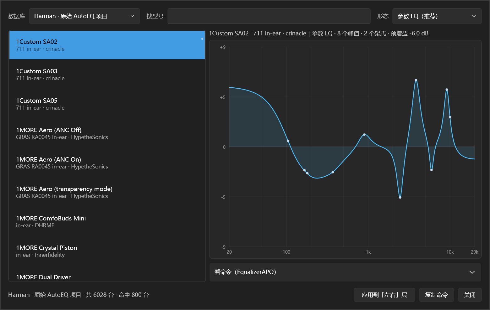

# AutoEQ 集成说明

主界面上那个 `预设EQ` 按钮，做的事和 Peace 里的 AutoEQ 界面一样：选中耳机型号，拿一份已经算好的校正曲线，一键套到 EQ 上。

不同之处只有一条：这里不依赖 Peace 运行，读的是同一份数据。



右边那块是这条校正的频响，不是命令文本：

- 横轴 20 Hz–20 kHz，对数刻度；竖轴按曲线幅度自动缩放（±6 到 ±24 dB）
- 曲线上的小白点是滤波器中心频率（图形 EQ 没有单点，就不打点）
- 曲线画的是滤波器形状，不含预增益——预增益写在上面那行说明里
- 想看原始命令就展开底下的「看命令（EqualizerAPO）」，里面的文本框是只读的，需要就手动选中复制

---

## 数据从哪来

Peace 把四个 AutoEQ 结果库压在一个 7z 里，随它的 exe 发布：

```
Source code\Peace\AutoEQ\AutoEQCompressed5.7z
  ├─ AutoEQCompressedHarman5.txt    原始 AutoEQ 项目（Jaakko Pasanen），Harman 目标
  ├─ AutoEQCompressedIEF5.txt       iwalton3 分支，IEF neutral 目标
  ├─ AutoEQCompressedIEFBass5.txt   iwalton3 分支，IEF neutral + 低音
  └─ OPRAEQCompressed5.txt          OPRA（Roon Labs 等），只有参数 EQ
```

这四份已经解开放在 `src/PeaceWpf/AutoEqData/`，构建时原样复制到输出目录的 `AutoEqData/`，运行时按需读。

要换新数据：拿新版 7z 解开，覆盖这四个 txt 即可，文件名不用改。改完重新构建。

也可以不重建，直接把环境变量 `PEACEWPF_AUTOEQ_DIR` 指到任意目录（里面放这四个 txt）。

## 文件格式

一行一条记录，首字母是类型：

| 首字母 | 含义 |
|---|---|
| `5 8853` | 第一行：格式版本 5，后面那个数不是设备数，是「结果」数 |
| `D` | 一台设备的开始，后面是型号 |
| `M` | 测量者 / 来源 |
| `W` | 佩戴与耦合方式（`711 in-ear`、`over-ear`…） |
| `A` | 数据行：`A` + 预增益 + 一串滤波器 |
| `R` | 图形 EQ：127 个值，每个值前面一个 `R` |
| `O` | OPRA 库里这份结果的相对路径 |

`A` 行里滤波器是「字母 + 数字」连着写的，没有分隔符：

```
A-6M105G5.5Q0.7P180G-3.3Q0.57
  A  -6          预增益 -6 dB
  M  105 G 5.5 Q 0.7    105 Hz 低架 +5.5 dB，Q 0.7
  P  180 G -3.3 Q 0.57  180 Hz 峰值 -3.3 dB，Q 0.57
```

滤波器字母：`P` 峰值、`F` 固定频带（只有增益，频率取 31/62/…/16000，Q 固定 1.41）、
`L` 低架、`H` 高架、`M` 居中低架、`I` 居中高架。

固定频带那一行也以 `A` 开头，靠「预增益后面第一个字母是不是 `F`」区分——`AutoEqDatabase` 就是这么分的。

## 三种形态怎么落地

| 形态 | 能一键应用吗 | 为什么 |
|---|---|---|
| 参数 EQ | 能 | 直接变成点：峰值 → PK，低架/高架 → LS/HS/LSC/HSC，预增益一起设好 |
| 固定频带 EQ | 能 | 10 个固定频率的 PK，Q 1.41 |
| 图形 EQ | 不能，只能复制命令 | 它是一条 127 点的卷积曲线，点模型写不出来；Peace 也是直接写 `GraphicEQ:` 行 |

图形 EQ 的预览里给的是完整的 `GraphicEQ: 20 -0.3; 21 -0.3; …` 那一行，想用就点「复制命令」，
自己粘进 EqualizerAPO 的配置里。

## 应用到哪一层

- 只动「左右」层：整层被替换成这份等化，低音层不动。
- 预增益写到右侧那个「增益」滑杆（范围 ±20 dB，超出会夹住并在状态栏说明）。
- 算一步可撤回的改动：不满意按 Ctrl+Z 就回到原来的曲线。
- 和普通编辑一样是「试听」：声音立刻变，按「保存」才写回 `.peace` 和 `peace.txt`。

## 架式滤波器现在能存住了

以前点模型只认 PK，读到低架/高架会当「非 PK」丢掉，保存时压成 PK。
现在 `EqPoint` 带 `FilterType`，四类架式（LS / HS / LSC / HSC）一路走通：

- `.peace` 的 `[Filters]` 段（`Filter2=8` 表示第 2 段是 LSC）
- `peace.txt` 的滤波器行（`Filter 2: ON LSC Fc 105 Hz Gain 5.5 dB Q 0.70`）
- 曲线仿真（RBJ 架式 biquad）
- 界面缓存 `ui-state.json`（多一个 `filterType` 字段）

低通、高通、带通、陷波、全通这些仍然不支持，读进来会丢并计数，保存时写成 PK。

## 数据归属

AutoEQ 数据来自 jaakkopasanen/AutoEq（MIT）与它的分支、以及 OPRA 项目，各有各的许可证。
本程序只读这些数据文件，不包含它们的代码。Peace 的 AutoIt 源码只用来对照格式，没有复制进本程序。
