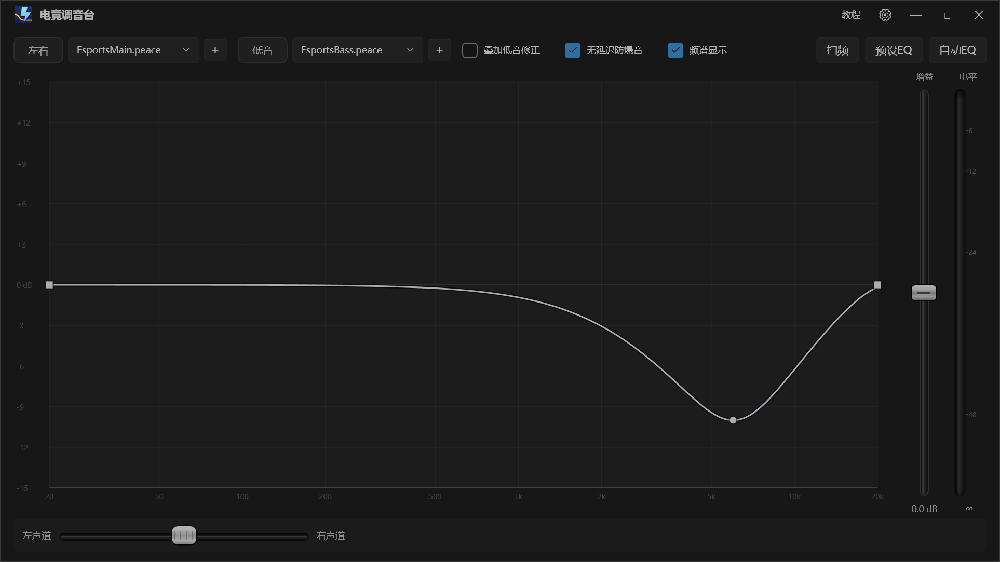

# 启动画面

2026-10-27 · 配合 exe 改名 EasyEQ 一起做

## 要的效果

打开程序时窗口是一整块纯黑，什么都不显示。LOGO 在窗口正中心，软件名「电竞调音台」在它下面。
停一下之后，LOGO 缩小着飞向窗口左上角，软件名先淡掉；LOGO 落到标题栏里那枚小标的位置时，
遮罩淡出，全部控件一起出现。左上角从此常驻 LOGO + 名字。

| 帧 | 内容 |
|---|---|
|  | 全黑，LOGO 正中，名字在下 |
|  | 飞行中，已经快到左上角 |
|  | 遮罩淡出后：小 LOGO 与名字在标题栏 |

## 怎么实现的

没有另开一个 Splash 窗口。就一层遮罩盖在主窗口上面：

- `MainWindow.xaml` 的 `RootGrid` 最后一项是 `SplashLayer`，`Grid.RowSpan="4"` 铺满四行，
  `Background="#FF000000"`。它在 XAML 里默认可见，所以首帧就是黑的，不会先闪一下界面。
- 遮罩里是一个 `Grid`：`SplashLogo` 严格居中，`SplashTitle` 用 `Margin="0,206,0,0"` 悬在下面。
  LOGO 加了 `ScaleTransform + TranslateTransform`，缩放原点 `0.5,0.5`，动画只改这两条。
- 标题栏左侧的 `TitleLogo`（22×22）就是落点，遮罩淡出后它和飞过来的大 LOGO 位置重合，
  所以交接看不出断点。

## 时序（`MainWindow.PlayStartupAnimation`）

| 时间 | 动作 |
|---|---|
| 0 | 在 `Loaded` 之后一帧启动，先量起点终点 |
| 0–240 ms | LOGO、名字从黑里淡入 |
| 90 ms 起 | 名字开始淡入（比 LOGO 慢一点） |
| 470–670 ms | 名字淡出 |
| 620–1280 ms | LOGO 缩到 22/132 并平移到左上角，CubicEase InOut |
| 1280–1640 ms | 遮罩淡出，控件显现 |

几点说明：

- 起点终点都用 `TranslatePoint` 实测，不写死坐标。窗口尺寸、DPI、最大化都不影响。
- 窗口被最小化（开机自启且关掉了「启动时显示界面」）时不播，直接撤遮罩 —— 看不见的东西不浪费时间。
- 遮罩有背景色，动画期间会吃掉鼠标点击，不会误点到下面的控件。
- 如果遮罩因为什么原因没布局出来（尺寸为 0），直接撤掉，绝不让界面永远黑着。

## 图标与文件名

| 项 | 值 |
|---|---|
| 产物 | `EasyEQ.exe`（`AssemblyName`；命名空间仍是 `PeaceWpf`，没连锁改名） |
| exe 图标 | `Assets/EasyEQ.ico` 进 `<ApplicationIcon>` |
| 窗口/任务栏图标 | `Icon="Assets/EasyEQ.ico"` |
| 启动画面大图 | `Assets/logo.png`（1000×1000，从 LOGO.png 来；ico 只有 16/32/48，放大必糊） |
| 标题栏小标 | 同上，按 22×22 显示 |

`AssemblyName` 只影响产物名。运行时数据目录在 `AppPaths` 里统一成 `%LOCALAPPDATA%\EasyEQ`：
设置、保存备份、诊断输出、测量记录都落在那儿。

## 改名带出来的几处修正

- 数据目录：老版本在 `%LOCALAPPDATA%\PeaceWpf`。`AppPaths.MigrateLegacyData()` 在启动最早期跑：
  新目录里还没有 `ui-state.json` 时，把旧目录的文件补齐（只补缺的、不覆盖，`app\` 调试副本跳过），
  旧目录原样留着，想回退或清理都行。实机验证：新目录文件齐全、`ui-state.json` 与旧文件逐字节一致，
  之后只往新目录写，旧目录停在迁移前的时间。
- `run.cmd`：源码目录 `src\PeaceWpf` 不动（那是工程目录，不是数据目录），只把产物名和
  调试副本目录改成 `%LOCALAPPDATA%\EasyEQ\app`。
- `AutoStart`：自启值名从 `PeaceWpf` 改成 `EasyEQ`；读到旧值名就搬过来、删掉旧的，
  路径指往旧 exe 时也顺手改写——否则表现为「设置里明明是开的、开机却起不来」。

## 验收

- `dotnet build` 0 警告 0 错误，产物 `bin/Debug/net10.0-windows/EasyEQ.exe`。
- 实机连拍：黑屏居中 → 飞行 → 落位 → 控件全部出现，三帧见上。
- 标题栏显示「LOGO + 电竞调音台」，exe 在资源管理器里带 LOGO。
