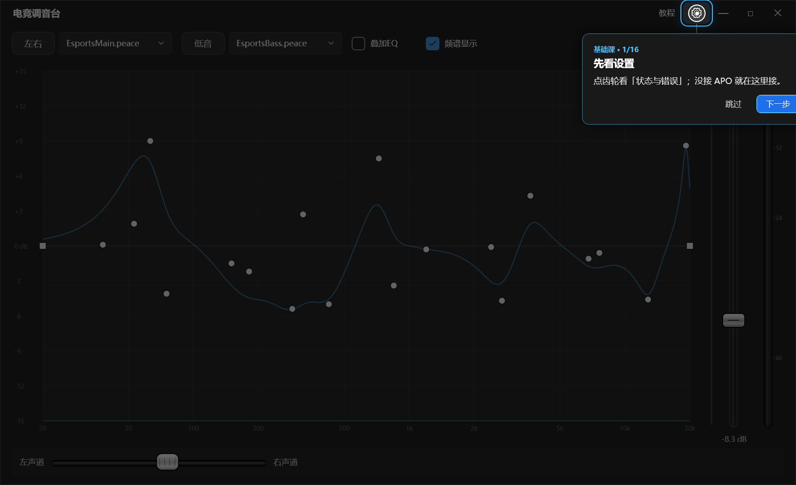
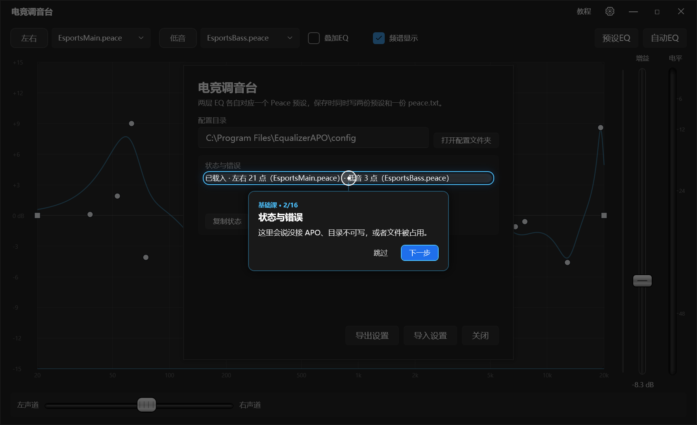
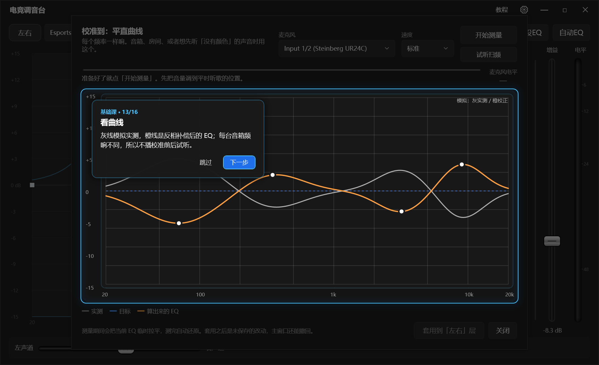
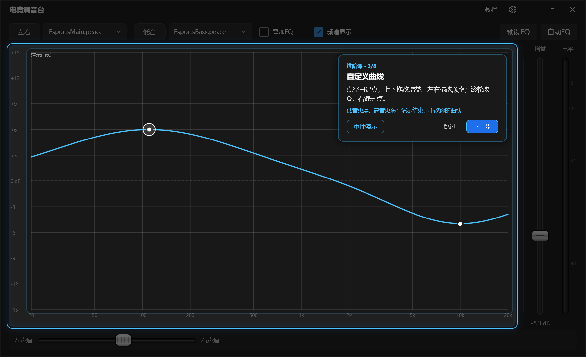
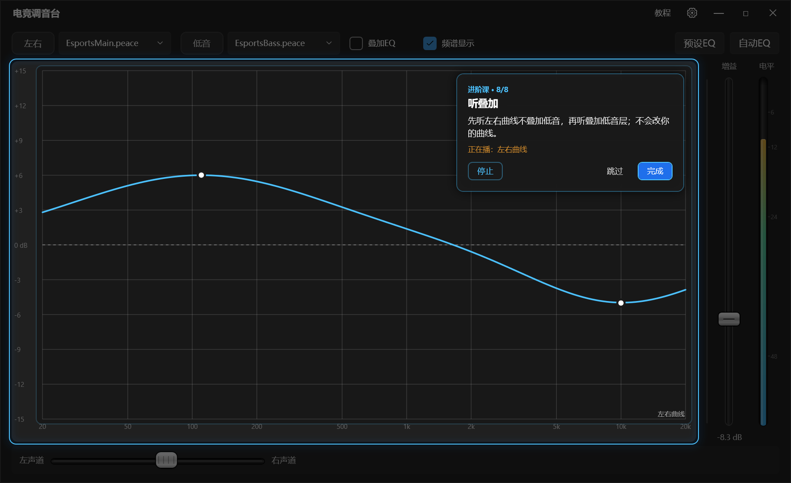
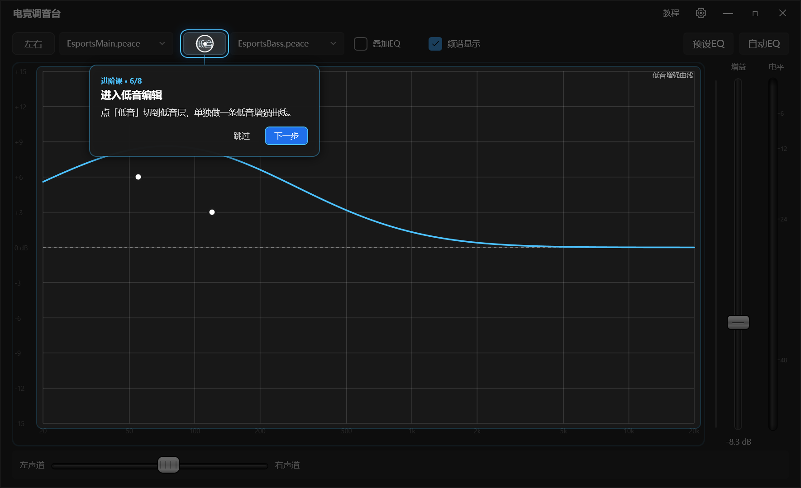
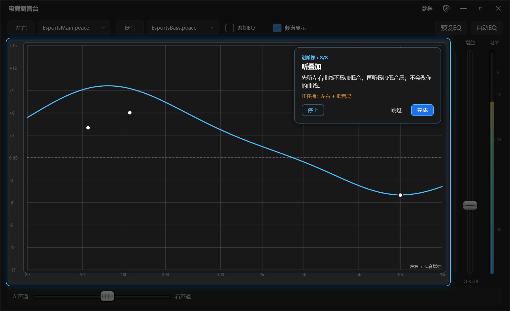
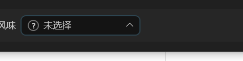

# 教程：一份就够了

> 这份文档覆盖教程的全部现状：怎么进入、两门课每一步指哪、演示了什么动作、颜色/遮罩/试听怎么工作、代码在哪、怎么验。
> 以前的零散教程说明已并入这里；README 只保留一段摘要和本文件的链接。

## 怎么进、怎么走

主窗口右上角的 `教程` 按钮在设置齿轮左边。点开只弹一个小窗口，二选一：

- **基础课（13 步）**：设置 → 预设EQ 搜索 → 自动EQ（选目标曲线 / 麦克风 / 测试模式 / 矫正起点 / 开始测量 / 套用）。
- **进阶课（9 步）**：预设 → 进左右编辑 → 真实曲线演示 → 左右试听对比 → 低音编辑 → 叠加开关 → 低音试听对比 → 总音量 → 风味。

选完以后铺一层全屏遮罩：

- 当前目标控件亮着，其余压暗；气泡只写一两句话。
- 动作演示用圆形光标 + 鼠标图标（左键 / 滚轮 / 右键会亮对应键）。
- `下一步` 在动作演完前不可用；最后一页变成 `完成`；`跳过` / `Esc` 随时退出。
- 气泡指到 `设置` / `预设EQ` / `自动EQ` / 「校准到哪条曲线」时，教程会打开对应窗口并跟进去；
  讲完自动关掉，回主界面继续。
- 教程打开的窗口不抢焦点；你自己已经开着的窗口会被直接复用，讲完也不会替你关。

## 曲线颜色与遮罩

软件本体就按这个规则画，不只是教程里：

- 不在编辑态：曲线白色。
- 编辑「左右」：蓝色实线；编辑「低音」：紫色实线。
- 另一层始终以灰色虚线垫在下面（编辑左右时能看到低音，反之亦然）。
- 进出编辑：颜色渐变过去；左右 ↔ 低音互换时，新实线从低透明度淡入、把灰色虚线盖住。
- 勾 / 取消「叠加低音修正」时，整条曲线按采样点插值变形，不是瞬间跳变。
- 进阶课遮罩会把曲线图整块从变暗层里挖掉，颜色和变形都看得清。

进「左右」编辑时，风味下拉是空的：显示「? 未选择」，图上不画任何风味手柄；手动选了一条才出现。

## 基础课（13 步）

| 步 | 在哪 | 指哪 | 说什么 |
|---|---|---|---|
| 1 | 主窗口 | 右上角齿轮 | 点齿轮打开设置：左栏运行环境，中栏使用习惯，右栏是软件本身。 |
| 2 | 设置 | 状态与提示 | 没接 APO、目录不可写、文件被占用都写在这里；「复制状态」可以整段带走。 |
| 3 | 设置 | 配置文件夹 | 所有 `.peace` 预设都在这里；路径不对就在这里重选。 |
| 4 | 主窗口 | `预设EQ` | 按耳机型号套一份现成校正，只替换左右层。 |
| 5 | 预设EQ | 搜型号 | 数据库保持默认，直接搜品牌 + 型号，空格表示都要命中。 |
| 6 | 主窗口 | `自动EQ` | 扫频 + 麦克风，测你自己的耳机或房间。 |
| 7 | 校准窗口 | 平直曲线 | 想让每个频率一样响（音箱、房间、或先听没有染色的声音）选这条。 |
| 8 | 校准窗口 | 哈曼曲线 | 入耳式常用目标：低频多 6 dB 左右，中高音有点起伏；内置是平滑近似。 |
| 9 | 自动EQ | 麦克风 | 教程按平直打开；平时会先让你选平直 / 哈曼。测量麦最好，耳机麦两端别太当真。 |
| 10 | 自动EQ | 测试模式 | 快速约 30 秒、标准约 2 分钟、更准约 5 分钟；先选档位。 |
| 11 | 自动EQ | 曲线区 | 灰线实测、橙线主层校正、绿虚线低音层，黄虚线是矫正起点；按住左右拖，两层按同一份实测重算。 |
| 12 | 自动EQ | 开始测量 | 音量调到平时位置，点下去等二十多秒到几分钟。 |
| 13 | 自动EQ | 套用 | 左右层和低音层一起套；低频只在试听扫频时叠加。 |

说明：

- 「平直 / 哈曼」那两步会把真实的选择窗口打开、分别指两张卡，但不替你点。
- 第 11 步「矫正起点」排在「开始测量」之前：先按住黄线左右拖，看清两层分工，再扫频。
- 矫正起点演示画三条曲线（灰实测、橙校正、绿虚线低音）+ 黄虚线，拖动时按新起点重算；
  曲线由主程序同一个 `EqCurveFitter` 算出（只是喂了一份写死的实测），不是另画的假线。
- 基础课不播校准前后试听：每台音箱频响不同，同一段试听代表不了你的设备。

## 进阶课（9 步）

| 步 | 指哪 | 说什么 |
|---|---|---|
| 1 | `左右` 预设下拉 | 选预设；按住右边末端拖动可改顺序，右键有更多操作。 |
| 2 | `左右` 模式按钮 | 点「左右」进入左右层；教程已经替你切好，这层改的是左右声道。 |
| 3 | 曲线区域 | 建点、上下拖改增益、左右拖改频率、滚轮改 Q、右键删点、Ctrl+Z 撤回；演示直接在图上做。 |
| 4 | `扫频` | 先听没改过的平直曲线，再听改过的左右曲线；只扫高频段 1 kHz–20 kHz。 |
| 5 | `低音` 模式按钮 | 点「低音」切到低音层；教程那条低音把 100 Hz 以下抬了起来。 |
| 6 | `叠加低音修正` | 退出编辑，看到合并后的曲线；再勾上开关，低频段自己抬起来。 |
| 7 | `扫频` | 先听低频段（不叠低音），再听叠加低音层的同一段；只扫 20–300 Hz。 |
| 8 | 右侧增益滑杆 | 声音太大或太小，就用这个推子调到合适的响度；它跟着「左右」这份配置走。 |
| 9 | `风味` 下拉 | 八种目标声音：选一个（比如脚步），把它的手柄上下拖；右键手柄还原 0 dB。风味只叠加。 |

### 教程数据与开关

- 开始进阶课时会先建两条临时预设：左右叫「高音曲线」，低音叫「低音加强」，并切到它们上面。
  演示期间任何保存、关窗口时选保存，都只会写这两个文件，碰不到你自己的预设。
- 如果配置目录里已经有同名预设、内容又不是教程曲线，会改用「高音曲线 教程」「低音加强 教程」，不覆盖。
- 两层临时换成教程数据：左右一条平线；低音是内置的那 5 个点（20 Hz +6.6、54 Hz +6.8、133 Hz +3.6、252 Hz −2.4、20 kHz 0，就是按 `EsportsBass` 调好的那条固定的）。
- 同时把顶栏三个开关拨成：叠加低音修正＝关，无延迟防爆音＝开，频谱显示＝开。
- 结束或跳过教程时，曲线、风味、三个开关、增益和均衡全部还原，两条临时预设文件删除。
  正常关闭 / 跳过都会走到这一步；如果进程被强杀，残留的临时预设会在下次启动时按内容清掉。

### 第 2、5、6 步的节奏

- 第 2 步：光标移到「左右」并点一下，约 1.1 秒后才真正进入编辑——先看到蓝框，再看到曲线变蓝。
- 第 5 步：同样先点、再延迟切到低音编辑，能看到左右实线淡出、低音紫色实线淡入。
- 第 6 步：先退出编辑（曲线回到「左右 + 叠加」的显示），点击动画播完后再真正勾上开关，
  低频段带变形动画抬起来。

### 第 3 步的动作与文字

演示直接在真实曲线控件上改草稿（`CreatePoint / PreviewPoint / ChangePointQuality / CommitPoint / DeletePoint / Undo`）：

1. 左键点空白 → 3 kHz 建点
2. 上下拖 → 拉到 −10 dB
3. 左右拖 → 频率拖到 6 kHz
4. 滚轮 → Q 从 1.0 压到 0.55
5. 右键 → 删掉这个点
6. `Ctrl+Z` → 撤回删除

每个动作都有一句文字说明，位置在鼠标图标右侧、与图标垂直居中，并跟随光标移动。
撤回时收起鼠标图标和说明，在原位换成「Ctrl」「+」「Z」两枚键帽；演示结束曲线停在该形状上。
`重播演示` 会先把曲线清回平直再重演，不会叠出多个控制点。
如果在演示没演完时点 `下一步`，会直接落到最终形状（6 kHz、−10 dB、Q 0.55），下一步看到的不是半截曲线。

### 两段试听对比（用软件自己的扫频）

两处都走真实播放通道：先把当前草稿写进 `peace.txt`，再启动 `ChirpPreviewPlayer`，放完还原。

- 第 4 步：先放平直（图上也临时显示平直），再放改过的左右曲线；只扫 1 kHz–20 kHz。
- 第 7 步：先放「左右、不叠低音」，再放「左右 + 低音层」；只扫 20–300 Hz。
  第一遍会临时关掉「叠加低音修正」（图上只画左右），第二遍再打开，能看到低频段抬起来。
- 两遍之间间隔约 0.15 秒；绿色扫频竖线按本次实际频段和时长行走，不再固定 20 Hz–20 kHz / 5 秒。

### 第 9 步风味

分两段演：

1. 光标点开顶部风味下拉，下拉在它正上方展开一份模拟列表（真实下拉同样向上弹），
   光标移到「脚步」上再点一下，列表收起。
2. 在图表区铺出这条风味的曲线，标题「模拟：脚步 2.5 kHz +6 dB」：手柄从 0 dB 拖到 +6 dB，
   最后右键同一处——光标不动，曲线直接复位成平直（增益回 0 dB，无过渡）。

整段画在遮罩上，不会改你真实的风味；`重播演示` 从头重放。

## 窗口与退出

- 气泡指到功能按钮后，点 `下一步` 才会打开窗口；不是一上来把所有窗口弹出来。
- 窗口不抢焦点，`下一步` / `跳过` / `Esc` 始终有效。
- 讲完某个窗口，教程自动关掉再回主界面；`跳过` 一次性关掉所有教程窗口。
- 退出后遮罩和教程打开的功能窗口一起移除；教程不会保存预设、不改配置文件、也不替你切模式
  （进阶课的切层和开关切换都在结束时还原）。

## 验证

- 构建：`dotnet build PeaceWpf.slnx -v q --nologo`
- 自测：`dotnet run --project tests/PeaceWpf.Core.SelfTest -c Debug --nologo`（期望「通过 357 项」）
- 教程回放：`powershell -NoProfile -ExecutionPolicy Bypass -File tools\tutorial-shots.ps1`
  会走完两门课并截图到 `docs/shots/`；加 `-TestAudio` 会真的点一下播放 / 停止。

截图（部分）：

## 相关代码

- `src/PeaceWpf/TutorialSteps.cs`：步骤表（基础课 13 步、进阶课 9 步），每步的窗口 / 目标 / 文案 / 演示标志。
- `src/PeaceWpf/MainWindow.xaml.cs`：`StartTutorial` 建遮罩并接入教程数据与试听；
  `PrepareTutorialStepAsync` 按步骤开关窗口、延迟进入编辑 / 切层 / 勾开关。
- `src/PeaceWpf/TutorialOverlay.xaml` / `.xaml.cs`：
  遮罩与气泡、跨窗口找目标、光标与鼠标图形、说明徽标、键帽、曲线演示、风味演示、试听状态。
- `src/PeaceWpf/TutorialCalibrationDemo.cs`：基础课自动EQ 演示的模拟实测 + 主程序拟合器。
- `src/PeaceWpf/TutorialChoiceWindow.xaml` / `.xaml.cs`：基础 / 进阶二选一。
- `src/PeaceWpf/Controls/EqGraphView.cs`：曲线颜色 / 参考虚线 / 渐变 / 遮罩挖洞需要的坐标换算。
- `src/PeaceWpf/ViewModels/MainViewModel.cs`：教程数据与还原、编辑态、风味选择、试听入口。
- `src/PeaceWpf.Core/Audio/ChirpPreviewPlayer.cs`：扫频播放，支持指定频段与时长。
- `src/PeaceWpf.Core/Audio/TutorialSweepPlayer.cs`：旧版教程自带的扫频（当前进阶课已改用上面的真实通道，保留仅作兜底）。
- `tools/tutorial-shots.ps1`：两门课的 UI 自动化与截图。
