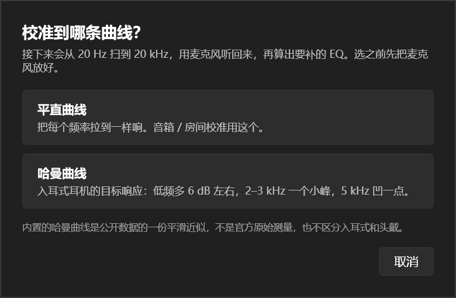

# 自动EQ 说明

主界面 `预设EQ` 右边那个 `自动EQ` 按钮。点开先问一句「校准到哪条曲线」——平直还是哈曼——
然后放一段扫频（快速约 25 秒、标准约 1 分 40、更准约 4 分 40），用麦克风听回来，
算出要补的 EQ 套到「左右」层；同时生成 20 Hz–矫正起点的低频矫正（默认起点 100 Hz）、整层替换「低音」层。

`预设EQ` 是查表：按耳机型号拿别人算好的结果。`自动EQ` 是当场测量：测你自己的耳机、音箱和房间。
两个按钮解决的不是同一件事。




---

## 一次测量在做什么

### 1. 播放：步进正弦，不是连续扫频

从 20 Hz 到 20 kHz，每个频点响 260 ms，然后静音 120 ms，再换下一个。
40 Hz 以下的点会响得更久（最多 600 ms，见 2.2），所以块长不再处处相等：
播放和分析都读同一份 `SweepSchedule`，谁都不许自己乘。

三档的差别只在「测多细、测几遍」：

| 档位 | 频点 | 单遍 | 扫几遍 | 整档耗时 |
|---|---|---|---|---|
| 快速 | 61（1/6 倍频程） | 约 25 秒 | 1（固定） | 约 30 秒 |
| 标准 | 121（1/12 倍频程） | 约 48 秒 | 2（固定） | 约 2 分钟 |
| 更准 | 240（1/24 倍频程） | 约 93 秒 | 3（固定） | 约 5 分钟 |

次数是写死的：不做「两次测稳就停」，也不会自己加轮。打开窗口默认「快速」。
想再多测一遍，自己点「继续测量」——它固定只扫 1 遍，不看你选的档位。

换档（快速/标准/更准）会先弹一句确认，确认后清掉上一份结果、按钮回到「开始测量」：档位同时决定频点表和推子密度，
留着旧结果再切档，「继续测量」会拿旧方案去套、按新密度重拟合，图和摘要就成了两套口径。
测量期间下拉是禁用的。

用步进正弦而不是 chirp，是因为 chirp 要把每个频率从录音里分出来，得靠反卷积或者严格的时间对齐；
而这里播放和录音各走各的时钟，中间还隔着 EqualizerAPO 和 WASAPI 的缓冲，
对齐误差几十毫秒是常态。步进正弦每个频点之间留一段静音，靠「有没有声音」就能切段，
延迟多少都不影响结果。

代码在 `Audio/SweepPlan.cs`（频点与时间常量）、`Audio/SweepSchedule.cs`（每块的时长与测量窗）、
`Audio/ToneSweepPlayer.cs`（生成与播放）。

### 2. 录音与分析

`Audio/MicrophoneCaptureService.cs` 抓默认录音设备（也可以在下拉里选），攒成一段单声道浮点采样。
打开设备先录 500 ms 整段丢掉（刚开设备时的杂音），再录 300 ms 干净环境声留在缓冲里当噪声参考；
播完再多收 600 ms，收混响尾巴。

`Audio/SweepAnalyzer.cs` 有两条路，都完整保留，随时能切：

| 引擎 | 怎么做 | 什么时候用 |
|---|---|---|
| 单频相干（默认） | 同步音定原点、每块 ±30 ms 局部对齐、Goertzel 只探目标频点、算纯度、分带噪声底 | 正常测量 |
| 宽带 RMS（旧） | 同步音定原点、固定网格分段、每段宽带 RMS | 对比测试 |

时间原点靠 1 kHz 同步音：400 ms、接近满幅，比任何频点都长也响得多。找到它结束的位置，
空出 200 ms 就是第一个频点。20–56 Hz 这类放不出来的频点不会把整条扫频带偏。

#### 2.1 单频相干：只问「我播的这个频点有多响」

- **Goertzel 单频检测**（`Audio/ToneProbe.cs`）：窗口里只取 f 这一根谱线，别的频率不算。
  旧的宽带 RMS 把窗内噪声和别的声源一起算进去，而且噪声是加性的：6 dB 信噪比时读数偏高约 1 dB，
  12 dB 也有 0.3 dB，低频、远场、薄弱的点被系统性垫高。窗长够 3 个周期就截到整周期再算，
  所以 20 Hz 只给 160 ms 也能解准。
- **纯度**：目标频点功率 / 窗口总功率。干净正弦接近 0 dB；混进音乐、说话时总功率涨而目标不涨，
  这个数掉下去。低于 −9 dB 判这一段不可用——旧实现里这种窗和干净窗一样被照单全收。
- **分带噪声底**：在静音段上对同一根谱线做同一个 Goertzel，再按 1/3 倍频程取中位。
  宽带噪声底是一把尺子量所有频点，低频隆隆声会把 20–80 Hz 的门限抬死。
- **局部对齐**：每块在 ±30 ms 内找能量最大的位置再取窗。播放和录音是两个时钟域，长扫频会漂；
  固定网格吃到漂移就把窗口挪进静音。落点差不到 0.25 dB 时取最靠近 0 的，不去追反射。
- 测量窗取「跳过 80 ms」到「响声结束前 20 ms」；旧的 80–240 ms 就是这条公式在 260 ms 上的结果。

#### 2.2 低频单点加长

40 Hz 以下按「至少 10 个完整周期」加长：20 Hz 响 500 ms，31.9 Hz 320 ms，40 Hz 以上回到 260 ms。
整条只多几百毫秒。

理由不是「多听一会更准」——单频正弦的稳态幅度 260 ms 就够解出来。是房间模态：小房间 30 Hz 的
T60 常常 0.5–1.5 秒，260 ms 只把模态激励到一部分，读数取决于在衰减的哪一段取窗。
加长到 10 个周期以上，读到的才是「推起来之后有多响，而不是刚好在这一刻有多响」。

`SweepTiming.Legacy` 是原来的均匀 260/120，一比一保留。

#### 2.3 多遍合并：先剔离群，再取中位

`SweepMeasureService.Merge`：每个频点先按中位绝对偏差（MAD）圈出可信的那几遍，
偏离超过 max(6 dB, 3×1.4826×MAD) 的丢掉，再取中位。两遍差得远时算不出 MAD，
按纯度选；纯度也分不出来时取较低的那个——干扰只会把读数抬高，不会压低。

偶数遍取中间偏后那个，不做平均：平均会被一个坏值拖走。

分段数必须正好等于这一轮的频点数（61 / 121 / 240）。对不上就报错并让人重来，
**不猜**——错位的频率写进 EQ 比没有更糟。

最后全部减掉 1 kHz 附近的中位数。麦克风增益、系统音量、喇叭灵敏度都混在绝对值里，
EQ 只需要「相对 1 kHz 哪里多哪里少」。

#### 2.4 新旧怎么对比

- `PEACEWPF_SWEEP_ENGINE=legacy` 退回旧引擎（时间表也跟着退回均匀 260/120）。
- `PEACEWPF_SWEEP_LOWFREQ=0` 只关低频加长，其余照旧。
- 每次测量的原始数字写在 `%LOCALAPPDATA%\EasyEQ\sweep-last.txt`：每点一行
  （电平、信噪比、纯度、对齐偏移、各自的噪声底）。时间表是均匀的时候，还会用另一套引擎
  在同一段录音上再跑一遍，附一段逐点差值——一次测量就能看到两边差多少。

这一步是纯数学，自测里直接喂合成的扫频信号验证，不需要声卡。

### 3. 目标曲线

`Calibration/TargetCurve.cs`：

- **平直**：全 0 dB。音箱、房间、或者想先听「没有颜色」的声音。
- **哈曼（入耳式）**：一组平滑过的控制点，低频 +6 dB 左右，2–3 kHz 一个小凸起，5 kHz 凹一点，
  10 kHz 以上再上翘。

**哈曼那份是近似**：按公开目标的形状手写的控制点，不是官方原始测量数据，也不区分入耳式和头戴。
界面上写明了这一点。要精确的目标曲线，把 REW 测的曲线导进 `预设EQ` 或者自己算好写进 `.peace`。

### 4. 拟合：解线性方程组，不是逐点填

`Calibration/EqCurveFitter.cs`。

修正量 = 目标 − 实测。**主层在矫正起点以下不参与**：那里是单元下潜、箱体谐振和麦克风低频截止的
硬限制，主层的推子补不出来，还会把整条目标拖低、把预增益压下去（就是「校准完整体变小了」的主因）。
修正量在起点前 20% 淡出到 0，第一个推子落在起点往上 1/6 倍频程（默认 100 Hz 时就是 80→100 淡出、
112 Hz 起头）。起点以下交给低音层，见 4.4。

修正量先按三分之一倍频程平滑，再夹在 **+9 / −12 dB** 之间（提升再多，失真和削波都会冒出来）。

然后把修正量变成一排峰值滤波器，全部从 112 Hz 到 16 kHz，段距跟速度档走：

| 档位 | 段距 | 段数 |
|---|---|---|
| 快速 | 1/2 倍频程 | 16 |
| 标准 | 1/3 倍频程 | 23 |
| 更准 | 起点–4 kHz 用 1/4，4–16 kHz 用 1/3 | 28 |

Q 由**每段自己的邻居**算（不是档位平均段距）再乘平滑系数，因为「更准」档的网格本来就是两段密度。
每一段自己的 Q 还会按局部陡缓微调，平坦处放宽、陡峭处收窄，上下限 0.75–1.25 倍。

这里有个坑：相邻滤波器在彼此的中心频率上也有增益（半倍频程、Q 2.8 时约 −3 dB），
如果每段直接填修正值，整条曲线会补过头。所以把它当成线性系统 `A·x = 目标` 解：

- `A[i][j]` = 第 j 段在 f_i 处、单位增益时的增益；
- 解出 `x` 之后再用真实响应修正两轮，抹掉「dB 可以相加」这个近似的残差。

第一版用的是简单迭代，收敛得又慢又振荡（算出来低频段在 +9 和 −12 之间来回跳），
换成列主元高斯消元之后一次就对上了。

预增益按整条曲线的最高点往下压，只压不提。

### 4.1 段的中心不是钉死的

等距格点管的是「每段一片」，不问那一片里有没有坑：3.2 kHz 的推子补不了 3.4 kHz 的窄谷，
因为它的中心压根不在谷上。多测几个点能看见那个谷，但看见不等于补得动。

所以拟合会算两套摆法：一套钉在格点上，一套让每段在自己的格点 ±半个段距内挪到 |修正量| 最大的位置，
相邻两段至少留 1/6 倍频程（挨太近方程会接近奇异，解出来的增益一正一负互相抵消）。
两套各跑一遍 Q 搜索，按「起伏 + 残差」打分取更好的那套。

挪过去不更贴就自然退回格点，所以打开它不会更差，只多花一遍解方程的时间。
代码是 `PlaceFrequencies`，`EqCurveFitter.Fit(..., movableBands: true)` 打开——自动EQ 窗口一直是开着的。
测完那一行摘要会写清楚是「N 段按实测挪出了格点」还是「段频率留在格点上」。

### 4.2 波峰波谷上的 Q 会自动调小

段距是均匀的，实测里的峰和谷不是。一个又深又窄的坑，用跟段距一样宽的推子去追，补出来是个比源曲线更细的尖刺；
下一轮再测，看见的就是「多出来一个峰」。所以这一段做两件事：

1. **按深度先放宽。** 每段自己要补多少 |dB| 决定它比基准 Q 宽多少：12 dB 的坑放宽 35%，
   3 dB 的小修只放宽 9%。只放宽、不收窄——收窄在这套数据上没有好处。
2. **解完再逐段收尾。** 从增益绝对值最大的段开始，一段一段试更宽的 Q（×0.8 / ×0.65 / ×0.5，最低 2.0），
   每改一段把整条重新解一遍，拿「实测 + 补出来的」曲线比：更平就留下，不更平就退回上一档。

第 2 步的尺子是 1/24 倍频程上的最大相邻落差；残差整轮只给 0.3 dB 预算——宁可少补一点，也别补出一个新峰。
它只往宽走、只在更平时接受，所以不会把结果调坏。代码是 `QualityPerPoint` 与 `RelaxQuality`。

两步都只在测量覆盖了整段（20 Hz–20 kHz）时才做。实时预览只测了一截，格点里那些还没测到的频段目标值是 0，
放宽会把增益漏过去——测到的地方平了一点，没测的地方反倒鼓起来。

预增益按整条曲线的最高点往下压，只压不提。

### 4.3 窄坑不吃提升额度

实测（2026-10-25，UR24C + 房间）里有只占 1/12 倍频程的深坑，比如 640 Hz 附近 −12 dB 的零点。
那是麦克风/单元干涉的干涉谷，EQ 补了也听不出来，但提升它要把预增益压下去——整段音乐都小一截。

判据是两条一起看：**半高宽 < 1/12 倍频程，并且原始深度 > 10 dB**，满足就整个放弃。
半高宽和深度都在平滑前量——平滑会把 14 dB 的零点抹到 6 dB，用平滑后的深度就判不成针尖了。

为什么不用「平滑后的宽带需要 + 允许量」：那条判据依赖 `Smooth` 的峰值保留率
（传 1.0 时单点脉冲只剩一成），宽窄信息在平滑里已经糊掉。半高宽是直接量的，
1/6 倍频程的房间谷测得出来，1/14 的干涉零点也测得出来，不经过任何平滑。

为什么不能只靠半高宽：单点谷的半高宽是 0，和单点针尖量出来一样。光看宽度，
640 Hz 那种 5 dB 的浅谷也会被当成针尖整个放弃。深度把两者分开——1/14 的零点 14 dB，
640 那种看得见也听得着的谷 5 dB。标准档第一轮实测：640 留在 4.8 dB，预增益 −1.9，
和之前的 allowance 4.5 版（4.5 dB / −2.2）基本持平，但判据只看曲线本身，不依赖平滑的怪行为。

**已知隐患：`Smooth` 的窗口单位是自然对数，不是倍频程。**
`Smooth(values, frequencies, widthOctaves)` 内部用 `Math.Log(hz)` 算距离，所以传 1.0
实际是 1/ln2 ≈ 1.44 倍频程的窗口；而且三角形权重加归一化之后，单点脉冲只剩一成。
自测里用脉冲法把这两件事钉住了（「Smooth 传 1.0 时脉冲只留一成」）。

2026-10-26 试过「窗口按档位（段距 × 倍数）加按频率（低频 1.5、高频 3）分层」：
方向本身是对的——低频窄坑是房间模式和单元谐振，值得补；高频窄坑多是单元干涉、分频相位，
补它只换来振铃和相位失真。但按倍频程估出来的窗口全偏宽，1/14 的针尖被放过，
预增益掉到 −7.4，反馈轮第二轮的残差也从 1.2 退到 1.7，最后整轮回退。
要重新试，先改 `Smooth` 的单位（内部乘 ln2，让参数名副其实）。

### 4.4 低频矫正单独写给「低音」层

主层从「矫正起点」往上 1/6 倍频程起，起点以下一个推子都没有。这一段由「低音」层单独接：

- **矫正起点默认 100 Hz，可以在自动EQ 的曲线图上拖黄色竖线改，范围 40–400 Hz。**
  拖动时曲线实时跟随重算，用的是和松手后同一个完整搜索（不摆位差异、不换 Q 档），
  所以中途和最终形状一致，不会「一会儿平滑一会儿锯齿」。拖动中的结果只更新界面，
  不写预设文件、不进撤回栈；松手那一次才落盘。
- 20 Hz–矫正起点，每 1/2 倍频程一个峰值推子（20–100 Hz 约 5 个）。20 Hz 本身是频轴端点，拟合从 22.4 Hz 起，
  20–22.4 Hz 靠它的裙边；端点若有增益，合并时会并进主层同名端点。
- 目标 − 实测：平直目标就是反相实测，哈曼目标会额外抬上低频那约 6 dB。
- 上沿最后 20% 线性淡出到 0，和主层从起点往上 1/6 倍频程起的第一个推子接上，
  避免同一个凹陷补两遍。默认 100 Hz 时就是 80–100 Hz 淡出。
- 提升上限 +18 / 削减 −18 dB：低音炮和大单元的下潜补偿需要比主层（+9/−12）更多余量。
- 低频优先「整体平滑」，不追单个驻波峰谷：修正量先按**一倍频程**平滑。20–100 Hz 的房间模式常在
  半个倍频程里峰谷交替十几 dB，1/3 倍频程的推子本来就补不动；硬追只会解出 +18 / −13 交替的推子，
  曲线连着弯好几折（蛇形），还会吃掉十几 dB 预增益。
- 窄而深的驻波谷（半高宽 < 1/4 倍频程、深于 8 dB）整个放弃，只削峰，判据比主层那条 1/12 的针尖保护宽。
- **测不到低频时不再硬反相**：矫正起点以下可信点少于 4 个，就按左下补偿滑杆生成一条平滑的低频提升曲线。
  提升量 = 滑杆百分比 × 主层上限 9 dB × 3，封顶 +18 dB（滑杆 0% 时不写低音层）；
  0 增益点在矫正起点右侧 1/6 倍频程（和主层第一个推子同一位置），往低频按 smoothstep 平滑升起，20 Hz 附近接近满值。
  以前这里会拿外推出来的平线反相成 0 dB，或者把噪声里的孤立点反相成假峰。
- 和主层同一套拟合流程：几个候选 Q 各解一遍线性系统，按「起伏 + 残差」打分取最好的，
  再按深度放宽 Q、逐段收尾。低频段推子互相叠得厉害，固定 Q 直接解会一段鼓一段瘪。
- 预增益只看左右层（主层曲线的最高点），低频提升不参与：低音炮 / 低音单元的音量由下游自己管，
  硬按合并峰值压会把中高频一起拖小。代价是低频提得多时合并曲线可能削波。

**它不参与反馈轮次。** 测量时低音层不叠加（见 5.2），测回来永远是主设备的裸低频，
同一个实测只会得到同一条低频曲线，没有「测一轮再逼近」这回事。
低频曲线每次测量后按当轮实测重算一遍，但不会因为「继续测量」而变化。

### 5. 测量期间把 EQ 拉平

扫频信号也会经过 EqualizerAPO。如果当前层还挂着 EQ，测到的就是「EQ 之后」的声音，
算出来的补偿会再叠一层。

所以点「开始测量」时，`MainViewModel.BeginCalibrationMeasurementAsync` 会先备份 `peace.txt`、
写一份平直的进去，测完（不管成功失败）都还原。
配置目录不可写、或者根本没接 APO 时会跳过这一步，并在界面上说清楚「这次结果里包含现有 EQ」。

这一份平直文件**只写主层**，不写低音层。低频矫正不能进测量：设备不一定发得出 20 Hz–矫正起点的声音，
叠进去测到的就不是主设备本身，反相也跟着算错。

### 5.1 「继续测量」不拉平

**这里有个容易搞错的点，先记死：更准档点一次「开始测量」，内部就跑 3 轮，不是 1 轮。**

- **第 1 轮**：把 peace.txt 拉平，测裸设备 → 拟合出 EQ₁
- **第 2 轮**：把 EQ₁ 套到左右层上，测「补过之后还剩多少」→ 拟合 EQ₂
- **第 3 轮**：把 EQ₂ 套上去，再测一遍 → 拟合 EQ₃

轮与轮之间自动套用上一轮的曲线，**不需要用户点「继续测量」**。轮数跟着档位走：| 档位 | 一次「开始测量」跑几轮 |
|---|---|
| 快速 | 1 轮 |
| 标准 | 2 轮 |
| 更准 | 3 轮 |

代码里的 `AutoRoundCount = 1` 是旧的错误，早就该删；现在轮数由 `OnMeasureClick` 按 `SpeedBox.SelectedIndex` 决定，
`MeasureLoopAsync` 逐轮调用 `RunMeasurementAsync`，每一轮开头自动套用 `_plan`。

**实时预览只在第 1 轮开**（`_liveEqEnabled = previous is null`）。第 1 轮测的是裸设备，曲线边扫边长，
能看出个大概；第 2 轮起是在上一轮的曲线上做微调，实时重画只会让一条本来已经定住的线跟着抖，
所以那几轮图上**一直挂着上一轮的矫正曲线**（`_livePlan` 保持为空，画的是 `_plan`），
本轮拟合结果在轮末存进 `_plan`，下一轮开头整条换上——不逐点长，也不补间。
测完最后一轮时它自然成为最终结果。重测本轮同理：手上已有结果就不开实时预览。

「继续测量」是**第 4 轮**及以后，用在 3 轮还不够的时候。它**不管当前是什么档位，只再扫一遍**——
每点一次就多一轮「套上一轮曲线、再测一次」，不会因为档位是「更准」就一次跑 3 遍。
（判断依据是按钮点下去时有没有上一轮结果：`_plan` 为空 = 第一次「开始测量」，按档位轮数；非空 = 「继续测量」，固定 1 轮。）

**每轮只扫一遍**（`maxRepeats = 1`）。以前这里的 `maxRepeats` 按档位给 2–3，那是「同一套 EQ 下重复测几次取平均」，
中间不换曲线——看起来像 3 轮，实际上只有 1 轮在补，所以用户会看到「第三轮还是那么鼓」。

第一轮拉平，是因为要看裸喇叭。第二轮起不拉平了：按钮变成「继续测量」，点一下先把手上那份结果套到
「左右」和「低音」层，再用 `BeginCalibrationMeasurementKeepEqAsync` 只把主层写进 `peace.txt`，
测一轮，看补完之后还剩多少。低音层不进测量，所以测到的低频永远是主设备的裸响应。
一次只跑一轮，不会自己接着往下跑。

第二轮起，EQ 是**在现有曲线上小步微调**，不是从头重算：实测里含着已经套着的那套，
所以「离目标还差多少」直接看得见。新曲线 = 现在这条 + 九成的误差，每段最多挪 6 dB
（`EqCurveFitter.FitFeedback`，窗口里的 `FeedbackGain` / `MaxStepDb` 只是传参）。
误差大也只走一步，剩下的留给下一次点击——既不会一动不动，也不会因为一次测偏就整条翻过去。

主层在矫正起点以下仍然保持 0：上一版算法留在低频的 +9 dB 会在几轮里自己退掉，预增益跟着回正。
低频补偿现在由低音层负责，不参与反馈轮次（见 4.4）。

（更早的版本把整个误差一次叠上去，第二轮把补偿叠了两遍，gains 从 −6..6 跳到 −10..9；后来改成六成 / 3 dB，
稳是稳了，但第二轮看着仍然「起伏很大」。现在是九成 / 6 dB，自测里一段带房间模式的合成曲线
第一轮剩 3.6 dB、第二轮剩 1.1 dB。）

`AutoRoundCount` 现在是 1（点一下一轮）。想让它在一次点击里自己连着收敛，把这个数调大就行，
循环里已经带了收敛判断：离目标 1 dB 以内，或者这一轮只改了不到 0.5 dB，就提前收工。

上一轮的结果在测量期间不清空：图上还画着它，等新结果出来才换掉。
「套用矫正EQ」这个按钮仍然在，想手动套也行——套过了「继续测量」就不会再套一遍。

实时预览的 0 dB 参考也跟正式测量对齐了：都以 1 kHz 附近的中位数为准。
以前拿「已测点的中位数」，扫到低频段时那一段全是 20–100 Hz 的电平，参考点偏了二十多 dB，
预览曲线整体平移、拟合跟着带一个常数偏移，看起来就像「重新优化了一遍」。

---

### 5.2 预增益（PreAmp）

**时机**：拟合算完那一刻就出来，不是点「套用」才算。它存在 `CalibrationPlan.PreAmpDb` 里，
结果摘要当场显示「预增益 −X dB」；套用只是把这个已算好的值写进 peace.txt 的 `Preamp:` 行。

**公式**：由左下补偿滑杆 0–100% 决定，不再是固定的 `−峰值`。

- 前 50%（α = 滑杆 / 50）：`limit = peak × (1 − α)`，曲线最高只留到 limit，预增益 `−limit`。
  这段是拿「截掉一部分提升」换整体音量，峰值始终压在 0 dBFS，不产生削波。
- 后 50%（β = (滑杆 − 50) / 50）：预增益固定 0，`limit = peak × β`，曲线从 0 慢慢恢复到原样；
  峰值超出 0 dBFS 的部分就是允许的削波，图上把超过的那段染红。

滑杆默认 0%，等价于原来的「只压不提」；下限仍 clamp 到 −20 dB。

**起点**：从**用户拖的那条矫正起点**往上扫，不是固定 100 Hz。100 Hz 只是没动过时的默认值。
拖黄线改起点会按同一份实测重算两层，PreAmp 跟着变。

目标整体压量（0 到 −6 dB，设备够不着目标时把整条目标往下压）在**第一次拟合时算一次就固定**，
之后拖起点只重算形状、不重算压量。否则起点一挪，「起点以上最难达成的一段」变了，
压量跟着变，整条曲线就会上下平移——看起来像拖动时曲线自己在跳。

**范围**：只看主层（左右）的推子。低音层 `FitBass` 返回的是 `EqPointList`，不带 PreAmp；
合并写盘时两层共用一个 Preamp 线。低音提多少由它自己负责，**不参与 PreAmp 计算**——
不然低频端点一有提升，整条中高频都会被跟着压低，图也会整体往下掉。

### 5.3 激进倍率：第 3 轮起自适应

激进不是固定的一档，是个倍率 `_aggressiveScale`：

| 倍率 | gain | 每段最多挪 |
|---|---|---|
| 1.0（常规） | 0.9 | 6 dB |
| 2.0（激进） | 1.8 | 12 dB |

- **第 2 轮收尾**：只要后面还有轮，就无条件切到 2.0，不再按残差挑。
  残差小了就收手等于第 3 轮白跑。
- **第 3 轮收尾起**：按前两轮的残差比算下一轮，`scale = 1 + clamp(r₂ / r₃, 0, 1)`。
  这一轮变差（残差更大）→ 比值小 → 倍率往 1 退；还在改善 → 保持激进。
- 每轮残差记进 `_roundResiduals`，逐轮递推。trace 里会看到：

```
round residual=2.2
aggressive scale=1.81 (before=2.2 cur=2.8)
```

倍率只调 `FitFeedback` 的步长；`aggressive` 那个布尔还额外控制 `Fit` 放开限幅、跳过窄坑保护、平滑减半。

## 怎么用

1. 点顶栏 `自动EQ`；
2. 选平直或哈曼；
3. 选麦克风。测量麦克风最好；普通耳机麦也能测，只是低频和高频别太当真；
4. 点「开始测量」：快速扫 1 遍（约 25 秒）、标准 2 遍（约 1 分 40）、更准 3 遍（约 4 分 40），次数固定；
5. 看四条线：灰色是**实测**（包含当时已经套着的那套 EQ）、蓝色是目标和左右校正、紫色是低音层的低频矫正，
   红色虚线是预增益。灰色本来就不该是平的——它画的是「还没补」的样子；
   低频（20–80 Hz）常常在 −20 dB 以下，纵轴会按实测和低频矫正自动扩，紫色那段就是低音层要补的量。
   蓝线不碰黄线以下，那一段归紫色管；被削掉的提升越多越红，低频要到 12 dB 才全红；
   灰线只连「可信」的点，用单调三次插值画成平滑曲线（穿过每个点、峰谷不过冲）；
   矫正起点以下不看纯度，但信噪比门槛比中高频严（10 dB，中高频是 6 dB），
   而且**左右紧邻的点都不可信时，这个孤立的点也不采信**——低频贴近噪声底时，
   偶尔会有一两个点碰巧读得高、电平看起来也正常，拿它拟合会把低频拽出一个假峰；
   图上的空心圈和拟合用的是同一条判据（`EqCurveFitter.TrustedLowMask`），不会「图上可信、拟合没用」；
   矫正起点以上判脏或信噪比不够的点不进曲线，单独画成空心圈——
   看到空心圈就是「这里测到了，但不可信」，拟合会跳过它们、用邻点插值；
   测量途中灰线还有个浅一点的版本：这一轮已经测到的点边测边长，上一轮的结果同时留在图上；
6. 补偿滑杆在左下：前一半补整体音量，后一半放开提升、允许削波（见 5.2）；
7. 点「套用矫正EQ」：左右层换成主层校正，低音层整层换成 20 Hz–黄线 的低频矫正，叠加开关自动打开；
   然后回主窗口试听、保存；
8. 想再准一点就点「继续测量」：先套用一遍，再测一轮，看补完还剩多少。满意就再点一次，不满意也再点一次——
   一轮一轮往前挪，最后一轮的结果才是你要保存的；低频不进测量，所以低频曲线不会因为继续测量而变化；
9. 随时可以点「试听扫频」：五秒，20 Hz 一路扫到 20 kHz，走系统默认输出。
   手上有结果时放的是「主层 + 低频矫正」——这是唯一会叠加低频的地方，放完自动还原；
   测量前听一遍、套用后再听一遍，比看曲线直观——共振、齿音、"补过头的闷"都是耳朵先发现。

耳机测量：麦克风贴着耳罩或入耳口，别在开放环境里测耳机。
音箱测量：麦克风放在听音位，关窗、关风扇，房间反射会直接进结果。

### 麦克风矫正曲线（可选）

测量麦不是一把绝对平的尺子，所以左下角滑杆的左边有个「导入麦克风矫正曲线」。

- **文件**：两列文本（`.txt` / `.csv` / `.cal`），第一列频率、第二列偏差 dB。
  逗号、制表符、分号、空格都行；`1k`、`1kHz`、`1000Hz` 都当 1000 读。
  REW / UMIK / miniDSP 导出的原始文件可以直接用：表头、`#` 注释、`Sens Factor` 那行会被跳过，
  REW 拿 `*` 标的 0 dB 参考点按数据读。少于两个频点会直接报错，不会悄悄给你一条假曲线。
- **怎么套**：`实测 = 测量值 −（麦克风偏差 − 麦克风在 1 kHz 的偏差）`。
  减掉 1 kHz 那一项是为了让锚点不动——实测本来就以 1 kHz 为 0 dB，不这么做一导入曲线整条线会上下平移。
  频率之间按对数插值，曲线范围以外沿用最近端点。
- **作用范围**：修正后的实测既进拟合，也画在图上；麦克风曲线本身是图上那条青色细虚线（图例里的「麦克风」）。
  已经测过的结果会按同一份原始数据立刻重算，不用重扫；实时测量途中也是从第一个点起就扣掉。
  测量进行中按钮锁着不响应——中途换尺子会让一轮里前后半截不一致。
- **记不记住**：路径写进界面状态（`ui-state.json` 的 `micCalibrationFile`），下次打开窗口自动载入；
  文件被删或格式坏了就当作没导入，不弹窗拦人。右键按钮可清除；清除后同样按原始数据重算。
  路径不跟着设置备份走——它属于这台机器。

测量期间主窗口不再锁住：自动EQ 会新建「左右矫正 / 低音矫正」两份预设并切过去，主界面一直显示测得的曲线；
下拉切到别的配置曲线也不变，套用会覆盖当前选中的那份。预览期间主界面曲线可以直接拖改，松手后按补偿滑杆
重新截断、重算预增益再刷回来；预增益推子锁住。测量这几十秒里主窗口的试听写盘会暂停，避免和「拉平」
抢 `peace.txt`，测完恢复并把结果推过去。不点套用直接关窗口＝取消，切回进入前的配置并删掉本次新建的矫正预设。
点主界面任意位置会把自动EQ 窗口直接藏起来，再点 `自动EQ` 按钮按原位置显示并补一段淡入。

测量中关窗口会立刻掐断当前这一轮（`CancellationToken` 直接取消），不再等它跑完；
多轮测量一轮就可能几十秒，等下去等于关不掉。关掉之后当前层的 EQ 保持原样，不会有半截结果被写进去。

---

## 已知限制

- **麦克风不校准，结果就是「麦克风 + 耳机」的合成响应。** 普通麦低频掉、高频翘，补出来的 EQ 会带上它的形状。
  手上有测量麦的曲线就导入（见上）：它扣的是实测，不改曲线的拟合规则。
- **音箱在房间里测，房间反射会算进去。** 那其实是房间校正，不是音箱校正；换位置结果就变。
- 同一张表固定扫 1/2/3 遍（跟着档位走）取中位数，不做稳定性自停；「继续测量」固定只扫 1 遍。
- 纯度判据会把被污染的点判成不可用；可用点少于一半时界面会提示「重测本轮」。安静环境里它基本不触发；
  房间里一直有说话声、空调低频或音乐时，它宁可少给几个点，也不拿噪声去拟合。
  **矫正起点以下不受这条约束**：那一段只留信噪比门限，因为低频层的形状只能靠这些点，
  代价是低频可能出现很大的提升（有 +18 dB 上限兜着）。
- 两遍时中位数退化成平均，MAD 只能靠纯度在两个值里挑一个。两遍被同一段干扰污染时，
  数据里没有足够信息把它们分开——这时该加一遍，不是该调阈值。
- 旧引擎（宽带 RMS）和低频加长都完整保留，靠环境变量切（见 2.4）；要长期对比就各测一轮，
  `sweep-last.txt` 里会并排列出两套结果。
- 三档的频点数与时长预算是为「两分钟 / 五分钟 / 十五分钟」定的；要改看 `SweepPlan` 里的常量
  （`GapMs` 不能小于 100，否则分析时切不开段）。
- 哈曼曲线是近似（见上）。
- **主层在矫正起点以下不校准**，那一段交给低音层（20 Hz–起点，±18 dB）。主层第一个推子在
  起点往上 1/6 倍频程（默认 100 Hz 时是 112 Hz），所以起点附近还会差一两 dB，这是设计如此。
- **低频矫正只在试听扫频时叠加**：测量期间不叠，因为设备不一定发得出 20 Hz–矫正起点的声音；
  叠进去测到的就不是主设备本身。代价是低频曲线没有「测一轮验证」的闭环，只能按当前实测一次算定。
- 拟合上限 +9/−12 dB，低音层 +18/−18 dB（提升再多失真和削波都会冒出来）。
  段数跟疏密档走：16 / 23 / 28。想改就改 `EqCurveFitter` 的常量。
  低频层也用同一套 Q 搜索、按深度放宽、逐段收尾；它的残差 / 平坦度统计范围是 20 Hz–矫正起点。
- 段中心最多离开格点半个段距（它自己那一格的段距；两段之间至少留 1/6 倍频程）。挪得更远会让相邻段之间断档——
  真需要补更宽的东西，该换更密的一档，而不是把一段拉出去。
- Q 自动调小是贪心的：一次一段、只往宽走、只看「套上去是不是更平」。两段一起动手那种全局最优没试过。
  下限 2.0——再宽就不是「补这一段」：实测放到 1.2 时，一个窄目标会逼推子用 +9 dB 去堆，补过头还压低预增益。
- 按深度放宽和逐段收尾都要求测量覆盖到该层的上沿（主层 16 kHz、低频层 = 矫正起点）。
  实时预览只测了一截，这两步跳过（否则增益会漏到没测的地方）。
- 套用会同时替换「左右」和「低音」两层：覆盖主界面当前下拉选中的那两份配置，低音层的原内容被整层替换
  （套用前主界面可撤回）。不点套用直接关窗口＝取消预览，不会动任何配置。
