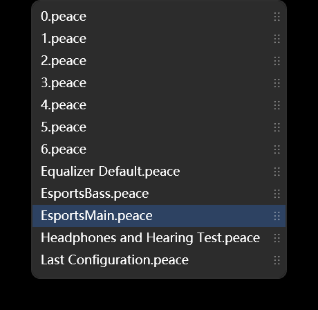
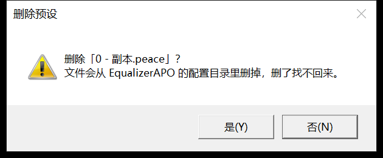

# 预设下拉：拖动排序、重命名、复制、删除

「左右」和「低音」两个按钮右边各有一个下拉，列的是 EqualizerAPO config 目录里的 `.peace` 文件。
这两条下拉共用一份列表、一份顺序。

## 怎么用

| 想干什么 | 怎么做 |
|---|---|
| 改顺序 | 打开下拉，按住某一项右边那条 `⋮⋮`，上下拖到想要的位置再松手 |
| 重命名 | 右键那一项 → `重命名…` |
| 复制一份 | 右键那一项 → `复制` |
| 删除 | 右键那一项 → `删除…` |
| 下拉收着的时候操作当前预设 | 直接右键下拉框本身，菜单一样 |
顺序在松手时就存进 `%LOCALAPPDATA%\PeaceWpf\ui-state.json` 的 `presetOrder`，下次开程序照这个顺序排。
不在 `presetOrder` 里的名字（比如外面新丢进来的 `.peace`）按文件名的本地化顺序补在后面。

右键菜单是**就地弹在列表上方**的，下拉不会收起来 —— 选完一项、或者点菜单外面把它收掉，
列表还停在原处，可以接着挑。只有真选中了某一项（或者按 Esc）才会把下拉收起来。

## 这三项到底改了什么

操作的都是磁盘上的 `.peace` 文件，不只是列表里的显示：

- **重命名**：`File.Move` 改名。被「左右」或「低音」正用着的那条会跟着改内部记的文件名和界面选中，
  否则下一次保存会写回那个已经不存在的旧名字。重名会拒绝，不覆盖。
- **复制**：`File.Copy` 出一份新文件，名字默认 `<原名> - 副本.peace`（重名就往后排 `- 副本 2`）。
  新文件插在原文件后面，当前层不动。还没落盘的名字（只是下拉里的占位默认值）不能复制。
- **删除**：先确认（默认落在「否」）。正被某一层用着时，先切到别的预设再删文件；
  这一层还有没保存的改动时不让删 —— 删文件顺手把正在调的东西带走太不讲道理。
  下拉里至少留一条，删到只剩一条时拒绝。

## 两个拖动的细节

- 顺序是共用的一份：在「左右」里拖，'低音'的下拉也是同样的顺序。
- 列表的挪动不会改变「哪一层用哪个预设」。万一选择跟着漂了，代码会按记下的文件名拉回来
  （`MainViewModel.MovePreset`）。

## 为什么事件挂在条目上而不是 ComboBox 上

下拉弹层是另一个窗口（Popup），有自己的鼠标捕获。挂在条目上的 `PreviewMouseLeftButtonDown` /
`PreviewMouseMove` / `PreviewMouseLeftButtonUp` 是条目自己一定收得到的；
挂在 ComboBox 上则要靠事件跨弹层冒泡回来 —— 能通，但没必要赌那一层。
`PreviewMouseLeftButtonDown` 在抓手上被 `Handled` 掉，ComboBoxItem 就不会顺手选中并合下拉，
拖动才有地方可拖。

## 为什么菜单不用 ContextMenu

`ContextMenu` 是独立窗口，一打开就要拿走鼠标捕获。ComboBox 一旦丢掉捕获就把下拉收起来 ——
试过，右键的瞬间列表就没了。所以这三项是**画在弹层自己的可视树里**的：
找到 `ComboBox` 模板里的 `Popup`，把它的孩子（Wpf.Ui 的 `EffectThicknessDecorator`）临时换成
「原内容 + 一个透明画布」，菜单 Border 摆在画布上点下去的位置。同一个窗口、同一份捕获，
列表自然留着。点画布空白只收菜单；下拉自己关掉时 `DropDownClosed` 兜底再收一次。

下拉收着的时候右键下拉框本身，仍然用 XAML 里挂的那个 `ContextMenu` —— 那时没有弹层要保护。

## 相关代码

- `src/PeaceWpf/MainWindow.xaml`：`PresetComboItem` 样式（模板里的 `⋮⋮` 抓手 + 五个 EventSetter）、
  两个下拉的 `ItemContainerStyle` 和收着状态用的 `ContextMenu`。
- `src/PeaceWpf/MainWindow.xaml.cs`：拖动状态机、右键菜单、`AskText` / `AskConfirm` 两个对话框委托。
- `src/PeaceWpf/ViewModels/MainViewModel.cs`：`MovePreset` / `PersistPresetOrder` /
  `RenamePreset` / `DuplicatePreset` / `DeletePreset` / `ApplyPresetOrder`。
- `src/PeaceWpf/TextPromptWindow.cs`：只问一行字的小窗（重命名、复制用）。
- `src/PeaceWpf.Core/Model/UiState.cs`：`presetOrder` 字段。
