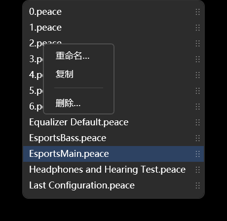

# 预设下拉：拖动排序、重命名、复制、删除

「左右」和「低音」两个按钮右边各有一个下拉，列的是 EqualizerAPO config 目录里的 `.peace` 文件。
这两条下拉共用一份列表、一份顺序。

## 怎么用

| 想干什么 | 怎么做 |
|---|---|
| 改顺序 | 打开下拉，按住某一项右边那条 `⋮⋮`，上下拖到想要的位置再松手 |
| 重命名 | 右键那一项 → `重命名…` |
| 复制一份 | 右键那一项 → `复制` |
| 删除 | 右键那一项 → `删除…` |
| 下拉收着的时候操作当前预设 | 直接右键下拉框本身，菜单一样 |
顺序在松手时就存进 `%LOCALAPPDATA%\PeaceWpf\ui-state.json` 的 `presetOrder`，下次开程序照这个顺序排。
不在 `presetOrder` 里的名字（比如外面新丢进来的 `.peace`）按文件名的本地化顺序补在后面。

右键菜单是**就地弹在列表上方**的，下拉不会收起来 —— 选完一项、或者点菜单外面把它收掉，
列表还停在原处，可以接着挑。只有真选中了某一项（或者按 Esc）才会把下拉收起来。

## 这三项到底改了什么

操作的都是磁盘上的 `.peace` 文件，不只是列表里的显示：

- **重命名**：`File.Move` 改名。被「左右」或「低音」正用着的那条会跟着改内部记的文件名和界面选中，
  否则下一次保存会写回那个已经不存在的旧名字。重名会拒绝，不覆盖。
- **复制**：`File.Copy` 出一份新文件，名字默认 `<原名> - 副本.peace`（重名就往后排 `- 副本 2`）。
  新文件插在原文件后面，当前层不动。还没落盘的名字（只是下拉里的占位默认值）不能复制。
- **删除**：先确认（默认落在「否」）。正被某一层用着时，先切到别的预设再删文件；
  这一层还有没保存的改动时不让删 —— 删文件顺手把正在调的东西带走太不讲道理。
  下拉里至少留一条，删到只剩一条时拒绝。

## 两个拖动的细节

- 顺序是共用的一份：在「左右」里拖，'低音'的下拉也是同样的顺序。
- 列表的挪动不会改变「哪一层用哪个预设」。万一选择跟着漂了，代码会按记下的文件名拉回来
  （`MainViewModel.MovePreset`）。

## 为什么事件挂在条目上而不是 ComboBox 上

下拉弹层是另一个窗口（Popup），有自己的鼠标捕获。挂在条目上的 `PreviewMouseLeftButtonDown` /
`PreviewMouseMove` / `PreviewMouseLeftButtonUp` 是条目自己一定收得到的；
挂在 ComboBox 上则要靠事件跨弹层冒泡回来 —— 能通，但没必要赌那一层。
`PreviewMouseLeftButtonDown` 在抓手上被 `Handled` 掉，ComboBoxItem 就不会顺手选中并合下拉，
拖动才有地方可拖。

悬浮缩略图是例外：条目的 `MouseEnter` 实测在弹层里不触发，所以气泡改成挂在弹层
`DropDownBorder` 上的 `MouseMove` 里找最近的 `ComboBoxItem`；拖动排序仍然靠条目自己的事件。

## 为什么菜单不用 ContextMenu

`ContextMenu` 是独立窗口，一打开就要拿走鼠标捕获。ComboBox 一旦丢掉捕获就把下拉收起来 ——
试过，右键的瞬间列表就没了。所以这三项是**画在弹层自己的可视树里**的：
找到 `ComboBox` 模板里的 `Popup`，把它的孩子（Wpf.Ui 的 `EffectThicknessDecorator`）临时换成
「原内容 + 一个透明画布」，菜单 Border 摆在画布上点下去的位置。同一个窗口、同一份捕获，
列表自然留着。点画布空白只收菜单；下拉自己关掉时 `DropDownClosed` 兜底再收一次。

下拉收着的时候右键下拉框本身，仍然用 XAML 里挂的那个 `ContextMenu` —— 那时没有弹层要保护。

## 滚动条在面板外左侧

两个下拉共用一套规则：**最多露出 20 行**（每行 24 px，所以 480 px），第 21 项起才滚动。
滚动条不画在选项区里，而是画在**下拉面板左外侧**的一条 12 px 窄槽：

- 面板和下拉框左边缘对齐；
- 滚动条整体往左挪一个槽宽，落在下拉框外面——不压文件名，也不占选项宽度；
- 不到 20 项时槽还占着位置，只是条不显示，所以面板不会横向跳。

实现上是一根独立的 `ScrollBar`（`PART_ExternalScrollBar`）跟着弹层里的 `PART_ScrollViewer`：
拖 thumb、滚轮滚动、拖动排序导致内容高度变化，位置都会同步。
样式是 `PresetScrollBar`（6 px 圆角滑块，没有上下箭头）。

下拉框本体高度是 40（`PresetCombo` 的 `MinHeight`）。模板里的 `ToggleButton` 必须写
`Style="{x:Null}"`：否则它会吃掉 Wpf.Ui 的隐式 ToggleButton 样式，被限成内容高度（约 10 px），
`MinHeight` 只会把外层 ComboBox 撑高，深色框本身不长——外面套一个大空壳，里面一条窄条。

## 悬浮看曲线

鼠标停在某一项上，右侧弹出一张 232×148 的缩略图，离开就收：

- **主曲线**是这条 `.peace` 里那套滤波器的实际响应，颜色跟下拉框属于哪一层走：
  左右是蓝 `#4CC2FF`，低音是紫 `#A78BFA`，和顶栏那两颗按钮同色。
- **风味**用主界面那八条彩线各自的颜色单独画，**不叠加进主曲线**——这样能分清
  “预设本来是什么样”和“哪条风味在动哪里”。低音预设没有风味，所以低音下拉里没有彩线。
- 气泡只放右侧；右边顶到窗口了就翻到左边，两边都不挡下拉框。竖直方向跟着悬浮的那一行，
  夹在窗口上下边界之间，不会跑出窗口。
- 拖动排序、右键菜单、下拉收起时气泡自动消失。

曲线数据来自磁盘上的 `.peace`（按文件修改时间缓存），所以外面改了文件，下次悬浮就能看到新形状。
只在内存里、还没落盘的名字会显示“这条预设还没落盘”。

### 风味方向下拉用的是同一套气泡

自动风味那个「方向」下拉复用这里的气泡（`PresetCurveTip` + `PlacePresetTip`），
区别只有画什么：

- **只画风味**，没有左右也没有低音。主曲线是九条风味按该方向的目标值叠出来的总响应，
  每条再用自己的颜色画一条细线。
- 标题带出处短名（「流行通用 · Pop」），脚注只有一行「会动哪几条」——一行放得下就不会被裁。
  来源的完整写法在 `docs/自动风味-目标表来源.md` 里。
- 位置用 WPF 自带的右侧吸附，不共用预设那边的「手算屏幕坐标 + 窗口夹紧」：
  风味列表是向上弹的，照那套算会被窗口上边界夹成同一个位置。

两处都能看：下拉收着时悬停在框上，看当前方向；展开后悬停在某一行，看那一行。
拖动排序那种顾虑在这里不存在，所以没有「不弹」的例外。

## 滚轮直接换预设

下拉收着的时候，鼠标停在下拉框上滚轮就上下换一个预设。走的是和点列表选中同一条路
（`SelectedItem` 绑定），所以切走前照样把当前层写回旧文件；下拉打开时滚轮留给列表滚动，不抢。

右侧那个小箭头展开/收起时会转半圈：收着朝下，展开朝上。

## 相关代码

- `src/PeaceWpf/MainWindow.xaml`：`PresetCombo`（下拉模板，左外侧滚动条 + 面板）、
  `PresetScrollBar` / `PresetScrollThumb`（细滚动条）、
  `PresetComboItem` 样式（模板里的 `⋮⋮` 抓手 + 七个 EventSetter，含悬浮缩略图的两个）、
  两个下拉的 `ItemContainerStyle` 和收着状态用的 `ContextMenu`。
- `src/PeaceWpf/MainWindow.xaml.cs`：拖动状态机、右键菜单、`AskText` / `AskConfirm` 两个对话框委托、
  缩略图气泡（`PlacePresetTip` / `LoadPresetTipData` / `HidePresetTip`）、
  `OnPresetScrollBarScroll`（外侧滚动条 → 弹层 ScrollViewer）。
- `src/PeaceWpf/Controls/PresetCurveTip.cs`：缩略图绘制（主曲线、风味彩线、网格；颜色由调用方给）。
- `src/PeaceWpf/ViewModels/MainViewModel.cs`：`MovePreset` / `PersistPresetOrder` /
  `RenamePreset` / `DuplicatePreset` / `DeletePreset` / `ApplyPresetOrder` / `PresetFlavors`。
- `src/PeaceWpf/TextPromptWindow.cs`：只问一行字的小窗（重命名、复制用）。
- `src/PeaceWpf.Core/Model/UiState.cs`：`presetOrder` 字段。
